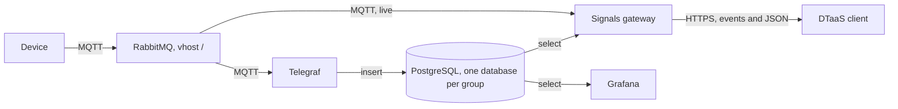

# Install the Signals Path

The signals path brings the readings of digital twins to the DTaaS client. A
device publishes a reading over MQTT to RabbitMQ. The signals gateway streams
it live to the browser. Telegraf stores it in the PostgreSQL database of the
GitLab group that owns the twin, where the gateway reads the history and
Grafana draws it. The browser holds no broker or database credential.



RabbitMQ, Telegraf, PostgreSQL and Grafana are
[platform services](../../services/cli.md), run by `dtaas-services`. The
gateway runs in a DTaaS Docker package, behind Traefik. This page lists the
steps of a new installation in order. The other pages of this section explain
each step:

- [Service Accounts](service-users.md): the accounts, databases and secret
  files that `dtaas-services` makes.
- [Configuration](config.md): the keys of `signals.yaml`.
- [Docker](docker.md): the gateway in the DTaaS packages and on its own.
- [Domain Kits](kits.md): a kit's bundle for the client and its tables.
- [Comparison](comparison.md): the signals path next to ThingsBoard and
  Eclipse Ditto.

The examples use the group `swim`, the MQTT project `SWiM`, the GitLab project
`DTaaS/jady` and the services host `services.foo.com`. Replace them with the
names of the installation, which follow the naming convention: a group name
matches `^[a-z][a-z0-9_]{2,31}$` and a topic has eight levels.

## 1. Start the Platform Services

The commands of this page come with `dtaas-services` 1.2.0, so install that
version or a later one:

```bash
pip install "dtaas-services>=1.2.0"
```

Generate and set up the platform services as the
[platform services page](../../services/cli.md) describes, then start them:

```bash
dtaas-services service start -s rabbitmq,postgres,grafana,telegraf
```

`compose.services.yml` holds RabbitMQ with its MQTT plugin, PostgreSQL,
Grafana and Telegraf. Without `-s` the command also starts the other
services of the file, such as GitLab and ThingsBoard.
`TELEGRAF_MQTT_SERVER` in `config/services.env` names the MQTT address that
Telegraf reads, `ssl://rabbitmq:8883` inside the Docker network by default.
With self-signed certificates, Telegraf has to trust
the certificate authority too: mount its certificate into the `telegraf`
service and name it in `SSL_CERT_FILE`, or Telegraf refuses the broker and
stores nothing.

## 2. Make the Accounts and the Group Database

Run these commands on the host of the platform services, in the folder that
`dtaas-services project generate` made. The account of the gateway reads the
projects it serves:

```bash
dtaas-services user add-signals -p SWiM
```

Then set up the history of each group once, with its projects and the GitLab
project paths of `DTaaS` whose twins belong to it:

```bash
dtaas-services user add-history -g swim -p SWiM -o jady
dtaas-services service restart -s grafana
```

The second command makes the Telegraf account, the database `swim` with the
tables `device` and `reading`, the read-only roles and the Grafana data source
`postgresql_swim`. Grafana loads a new data source when it starts. The
passwords and the owners file go to `secrets/` with mode 600.

## 3. Register a Twin

Write a twin file that lists the devices of the twin, each with its topic
without the quantity:

```json
{
  "group": "swim",
  "twin": "room_0224",
  "topic_prefix": "SWiM/CTO/room/0224",
  "devices": [
    {"topic": "SWiM/CTO/room/0224/seat48A/S/S-SWiM-CTO-room-0224-seat48A-TRH-0001",
     "brick_class": "Air_Temperature_Sensor"}
  ]
}
```

```bash
dtaas-services twin register -f room_0224.json
```

The command writes the `device` rows and then the Telegraf file of the twin,
after `telegraf config check` passes on it. Only readings of registered
devices are stored.

## 4. Declare the Signals in GitLab

The gateway serves a topic only when a twin in a GitLab project the user can
read declares it. Commit `digital_twins/<twin>/visualisation.json` to the
branch `master` of the project `DTaaS/jady`, with an `mqtt` transport that
lists the full topics:

```json
{
  "schemaVersion": "1.0",
  "transports": [
    {
      "adapter": "mqtt",
      "url": "mqtts://services.foo.com:8085",
      "topics": [
        "SWiM/CTO/room/0224/seat48A/S/S-SWiM-CTO-room-0224-seat48A-TRH-0001/temperature"
      ],
      "channel": "measured"
    }
  ]
}
```

The gateway reads `schemaVersion` and the `mqtt` transports of the file and
connects to the broker with its own account, not with the `url` of the file.
A topic must also start with a prefix of the owner's group in the owners file,
here `SWiM/`.

The Visualise tab lists the twins of the user's workspace, so copy the same
folder into `files/<user>/digital_twins/` of the installation too. The
gateway reads only the committed copy.

## 5. Configure and Start the Gateway

In the DTaaS Docker package of the installation, after its README has made
`config/.env` and `config/client.js`. `DEFAULT_USER` in `config/.env` is the
GitLab username of the user, or the client cannot list that user's twins.

1. Copy `config/signals.yaml.example` to `config/signals.yaml`. Set
   `gitlab-url`, `gitlab-client-id`, the services host in `mqtt-url` and
   `postgres-url` and the subnet of the Traefik network in
   `trusted-proxies`, as [Configuration](config.md) describes.
1. Copy the three files of `secrets/signals/` from the host of the platform
   services into `config/secrets/`, with mode 600 and owner uid 1000.
1. Uncomment `COMPOSE_PROFILES=signals` in `config/.env` and start the
   package. Traefik routes `/signals` to the gateway.

[Docker](docker.md) gives the commands for each package.

## 6. Point the Client at the Gateway

Set `REACT_APP_VIZ_SIGNALS_URL` in `config/client.js` to the `/signals`
address of the server (for example `https://foo.com/signals`), then recreate
the client:

```bash
docker compose --env-file config/.env up -d --force-recreate client
```

## 7. Check the Path

The health route needs no sign-in. Behind traefik-forward-auth every request
to `/signals` needs a browser session, so ask the gateway from inside its
container, in the folder of the package:

```bash
docker compose --env-file config/.env exec signals \
  node -e "fetch('http://127.0.0.1:4004/signals/health').then((r) => r.text()).then(console.log)"
```

It answers `{"status":"ok"}`. Publish a test reading on the declared topic,
with the payload of the naming convention:

```json
{"value": 24.87, "ts": "2026-11-06T17:40:08Z", "unit": "Cel"}
```

A device publishes with its own MQTT account. To publish one reading by hand,
the management API of RabbitMQ can send it to `amq.topic`, where the MQTT
plugin routes it with `.` in place of `/`
([RabbitMQ MQTT plugin](https://www.rabbitmq.com/docs/mqtt)). `curl` asks for
the password of the administrator of `config/services.env`. With a
self-signed certificate, add `--cacert` with the certificate of the
authority:

```bash
curl -u dtaas -H 'Content-Type: application/json' \
  https://services.foo.com:8084/api/exchanges/%2F/amq.topic/publish \
  -d '{"properties": {}, "payload_encoding": "string",
       "routing_key": "SWiM.CTO.room.0224.seat48A.S.S-SWiM-CTO-room-0224-seat48A-TRH-0001.temperature",
       "payload": "{\"value\": 24.87, \"ts\": \"2026-11-06T17:40:08Z\", \"unit\": \"Cel\"}"}'
```

Then check each part of the path:

| Part | Check |
| :--- | :---- |
| Stream | `POST /signals/stream` with `{"paths": ["<topic>"]}` answers with server-sent events: `state` with `connecting` and `live`, then a `sample` event for each reading published while the stream is open |
| Store | In the PostgreSQL container, `select * from reading order by time desc limit 1` in the database `swim` returns the reading |
| Range | `POST /signals/range` with `{"paths": ["<topic>"], "channel": "measured", "from": <ms>, "to": <ms>}`, times in milliseconds since 1970, answers `{"samples": [...], "truncated": false}` |
| Grafana | Explore with the data source `postgresql_swim` and the same query shows the reading |

The stream and range routes need the header `Authorization: Bearer <token>`
with a token that the DTaaS client OAuth application issued, such as the one
the client sends. Behind traefik-forward-auth the request also needs the
session cookie of the browser. For the store check:

```bash
docker exec postgres psql -U <POSTGRES_USER> -d swim \
  -c 'select * from reading order by time desc limit 1'
```

`<POSTGRES_USER>` is the administrator of `config/services.env`.

## 8. Add a Domain Kit

A domain kit, such as `soil-kit`, adds its pages and views to the client and
its own tables to the group databases, without a change to the client, the
gateway or Telegraf. [Domain Kits](kits.md) gives the steps.
