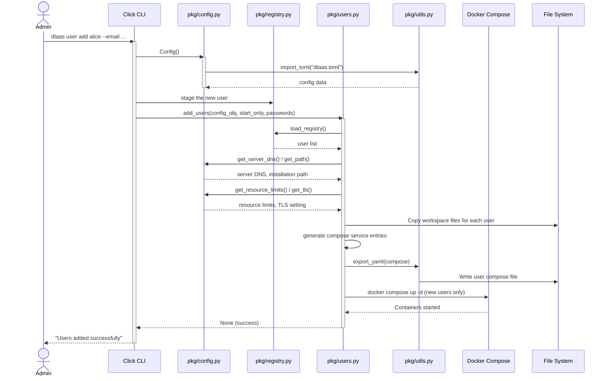

# Command Line Interface

The Command Line Interface (CLI) lets administrators manage a DTaaS
installation from the shell. It covers the whole deployment lifecycle:
generating and validating the configuration, generating deployment files
for each supported scenario, installing and uninstalling a deployment,
updating certificates and configuration in place, and adding, removing,
pausing and resuming users.

The user guide is the [admin CLI page](../../admin/cli.md), and the full
command reference is in `cli/README.md`. This page describes the
internal structure for contributors.

## Command Surface

Every command follows the grammar `dtaas <noun> <verb>`. The four nouns
are listed in workflow order.

```text
dtaas
├── config
│   ├── generate                  # write dtaas.toml + users.csv
│   ├── validate                  # check dtaas.toml, report all errors
│   └── reconcile                 # report or fix registry drift
├── deployment
│   └── generate --type X         # generate a deployment package
├── platform
│   ├── install                   # docker compose up of a deployment
│   ├── uninstall                 # tear down (optionally user files)
│   ├── update                    # --certs and/or --config, in place
│   ├── status                    # state of the installation
│   ├── stop / start              # core services only
│   └── pause / resume            # core services only
└── user
    ├── add                       # provision user workspaces
    ├── delete                    # deprovision user workspaces
    ├── status                    # state of additional users
    └── pause / stop / resume     # suspend or resume single users
```

## Package Structure

The CLI package is organised as follows:

```text
cli/
├── src/                          # Application source code
│   ├── __init__.py               # Package initialization
│   ├── cmd.py                    # Root 'dtaas' group, wires the nouns
│   ├── cmd_config.py             # 'config' commands
│   ├── cmd_deployment.py         # 'deployment' commands
│   ├── cmd_platform.py           # 'platform install/uninstall/update'
│   ├── cmd_lifecycle.py          # 'platform status/stop/start/...'
│   ├── cmd_user.py               # 'user add/delete/status'
│   ├── cmd_user_lifecycle.py     # 'user pause/stop/resume'
│   ├── cmd_options.py            # Shared Click options
│   ├── cmd_utils.py              # Shared command helpers
│   ├── cmd_user_utils.py         # User input resolution
│   ├── cmd_user_emails.py        # Emails given but not applied
│   ├── cmd_user_passwords.py     # Initial GitLab passwords
│   ├── cmd_deploy_utils.py       # Deployment command helpers
│   ├── pkg/                      # Implementation modules
│   │   ├── build.py              # Vendors shared code into src/
│   │   ├── certs.py              # Certificate placement
│   │   ├── cert_update.py        # In-place certificate rotation
│   │   ├── cert_validate.py      # Certificate pair validation
│   │   ├── config.py             # dtaas.toml parsing and access
│   │   ├── config_update.py      # In-place configuration re-apply
│   │   ├── config_validate.py    # Configuration validation rules
│   │   ├── config_validate_gitlab.py # [gitlab] validation rules
│   │   ├── constants.py          # Constant definitions
│   │   ├── deploy.py             # Install/uninstall orchestration
│   │   ├── deploy_config.py      # Scenario configuration mapping
│   │   ├── _deploy_data.py       # Per-scenario substitution specs
│   │   ├── gitlab/               # Optional GitLab user provisioning
│   │   ├── lifecycle.py          # Platform status/stop/start/pause
│   │   ├── messages.py           # Shape of user command output
│   │   ├── project.py            # Template copying for 'generate'
│   │   ├── registry.py           # User registry (JSON)
│   │   ├── registry_csv.py       # users.csv parsing
│   │   ├── state.py              # Runtime state cache
│   │   ├── user_files.py         # User file cleanup on uninstall
│   │   ├── users.py              # User add handler
│   │   ├── users_compose.py      # Per-user compose generation
│   │   ├── users_delete.py       # User delete handler
│   │   ├── users_gitlab.py       # GitLab account and token setup
│   │   ├── users_gitlab_records.py # Saved tokens and markers
│   │   ├── users_gitlab_targets.py # Users to provision in GitLab
│   │   ├── users_lifecycle.py    # Per-user pause/stop/resume
│   │   ├── users_utils.py        # User management helpers
│   │   ├── utils.py              # File I/O and utilities
│   │   └── validators.py         # Shared validation helpers
│   └── templates/                # dtaas.toml, users.csv and compose
│       └── ...                   # templates for user workspaces
├── tests/                        # Test suites and fixtures
├── pyproject.toml                # Poetry project configuration
└── README.md                     # Command reference
```

## Architecture and Design

The CLI is a Python package that uses the Click framework for command
parsing. Each noun is a Click group in its own `cmd_<noun>.py` module,
and `cmd.py` attaches the groups to the root `dtaas` group. Command
modules parse options, load and validate the configuration, and call
functions in `pkg/`. Docker operations go through python-on-whales.

`dtaas.toml` is the single source of truth. Every command reads it
through the `Config` class in `pkg/config.py`, and
`platform update --config` re-applies it to an installed deployment so
that the deployment does not drift from it.

The CLI also keeps two files of its own. `dtaas.users.registry.json`
(`pkg/registry.py`) records the additional users added with `user add`,
and `.dtaas.state.json` (`pkg/state.py`) caches what is known about the
provisioned user containers.

GitLab account provisioning in `pkg/gitlab/` is built on the
`gitlab_common` library. `src/pkg/build.py` vendors it from
`lib/gitlab_common/` into the source tree, so run it before running the
tests:

```bash
poetry run python src/pkg/build.py && poetry run pytest
```

### Main Modules

| Module               | Purpose                                        |
| :------------------- | :--------------------------------------------- |
| `cmd.py`             | Root group; attaches the four noun groups      |
| `cmd_user.py`        | User add/delete/status command definitions     |
| `pkg/config*.py`     | TOML parsing, validation, in-place updates     |
| `pkg/project.py`     | Template copying (`config generate`, `deployment generate`) |
| `pkg/deploy.py`      | Install/uninstall orchestration                |
| `pkg/lifecycle.py`   | Platform status, stop, start, pause, resume    |
| `pkg/cert_*.py`      | Certificate validation and rotation            |
| `pkg/users*.py`      | User workspace lifecycle                       |
| `pkg/registry.py`    | Registry of additional users                   |
| `pkg/state.py`       | Runtime state of user containers               |
| `pkg/utils.py`       | YAML/TOML I/O, template substitution           |

## Sequence Diagram

The following diagram shows how `dtaas user add` provisions a user:



## Error Handling Pattern

The CLI handles errors in two ways:

1. Most modules under `src/pkg/` raise exceptions.
2. `config.py` and `utils.py` return `(result, Exception | None)`
   pairs, and callers check the error before using the result.

The command modules turn both kinds of error into
`click.ClickException`, so the user sees a short message instead of a
traceback. Test commands with Click's `CliRunner` rather than
`subprocess`.

## Resource Limits Configuration

Administrators can limit the resources each user container may use, so
that one user cannot take over a shared server. The limits are set in
the `[common.resources]` section of `dtaas.toml`. The `set_limits` flag
turns enforcement on and off. When it is `false`, user containers are
created without limits and the other fields are ignored. The defaults
come from the `dtaas.toml` template:

| Parameter     | Description                      | Default       |
| :------------ | :------------------------------- | :------------ |
| `cpus`        | CPU core allocation              | `4`           |
| `mem_limit`   | Memory limit                     | `4G`          |
| `pids_limit`  | Maximum process count            | `4960`        |
| `shm_size`    | Shared memory size               | `512m`        |
