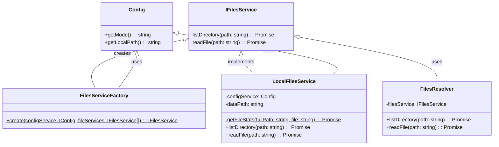
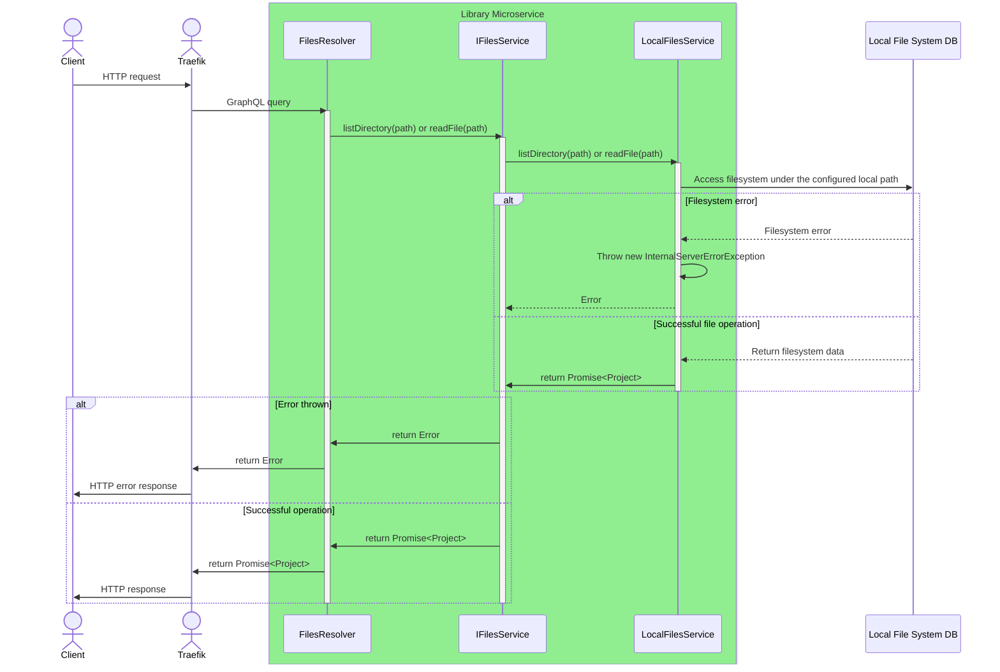

# Library Microservice

The Library Microservice gives access to workspace files in two ways: a
GraphQL API, and an HTTP file server that users can open in a web
browser. It reads files from the local file system or from GitLab, and
its API follows the GitLab GraphQL API. Both users and digital twins use
it to reach the reusable assets in the platform library.

!!! warning
    This microservice is still under heavy development. It is not yet a
    satisfactory replacement for the file server currently in use.

## Architecture and Design

The microservice is built with the NestJS framework and Apollo GraphQL.
It uses the Strategy pattern: a factory picks one of several file
storage backends (local file system or GitLab). The GraphQL API of the
library microservice is meant to be compatible with the GitLab GraphQL
service.

## Package Structure

```text
servers/lib/
├── src/                           # Application source code
│   ├── main.ts                    # Application entry point
│   ├── bootstrap.ts               # NestJS bootstrap configuration
│   ├── app.module.ts              # Root application module
│   ├── schema.gql                 # Auto-generated GraphQL schema
│   ├── types.ts                   # GraphQL type definitions
│   ├── graphql-options.ts         # Apollo GraphQL module options
│   ├── config/                    # Configuration module
│   │   ├── config.module.ts       # Configuration DI module
│   │   ├── config.service.ts      # Configuration service
│   │   ├── config.interface.ts    # Configuration interface
│   │   ├── config.model.ts        # Configuration model
│   │   └── util.ts                # Configuration utilities
│   ├── files/                     # Files module (core functionality)
│   │   ├── files.module.ts        # Files DI module
│   │   ├── files.resolver.ts      # GraphQL resolver
│   │   ├── files-service.factory.ts  # Backend factory
│   │   ├── interfaces/            # Service interfaces
│   │   │   └── files.service.interface.ts
│   │   ├── local/                 # Local filesystem backend
│   │   │   ├── local-files.module.ts
│   │   │   └── local-files.service.ts
│   │   └── git/                   # GitLab backend
│   │       ├── git-files.module.ts
│   │       └── git-files.service.ts
│   ├── enums/                     # Enumeration definitions
│   │   └── config-mode.enum.ts    # Backend mode enum
│   └── cloudcmd/                  # CloudCmd file browser integration
│       └── cloudcmd.ts
├── test/                          # Test suites
└── dist/                          # Compiled output
```

## Main Components

### GraphQL Resolver

The `FilesResolver` class exposes two GraphQL queries:

| Query           | Purpose                                          |
| :-------------- | :----------------------------------------------- |
| `listDirectory` | Returns directory contents (files and folders)   |
| `readFile`      | Returns file content as raw text                 |

### File Service Interface

The `IFilesService` interface defines the contract for all file backends:

```typescript
interface IFilesService {
  listDirectory(path: string): Promise<Project>;
  readFile(path: string): Promise<Project>;
  getMode(): CONFIG_MODE;
  init(): Promise<any>;
}
```

### Backend Implementations

| Backend              | Purpose                                      |
| :------------------- | :------------------------------------------- |
| `LocalFilesService`  | Accesses files from local filesystem         |
| `GitFilesService`    | Accesses files from GitLab repository        |

### Factory Pattern

`FilesServiceFactory.create()` picks the backend whose `getMode()`
matches the `mode` setting in the configuration file (`local` or
`git`). `files.module.ts` calls it once, when NestJS builds the
`FILE_SERVICE` provider, and the resolver receives the chosen service
through dependency injection. An unknown mode stops the service with an
`Invalid MODE` error.

## UML Diagrams

### Class Diagram



### Sequence Diagram

The factory has already chosen `LocalFilesService` at startup, so a
request goes straight from the resolver to the backend.



## Build and Test

Run from `servers/lib/`:

```bash
yarn build && yarn test:all
```

`yarn test:nocov` also runs `test/cloudcmd`, which needs a configured
`.env` and a running libms under pm2.
