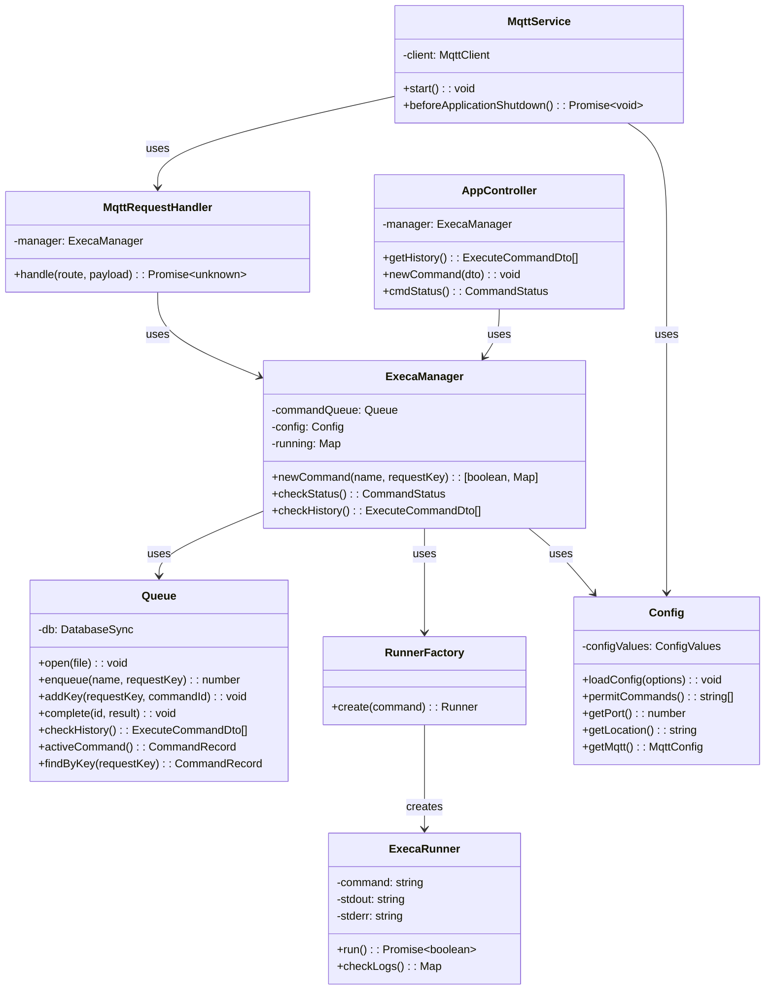

# Runner Microservice

The Runner microservice executes scripts for digital twins in the DTaaS
platform. It accepts HTTP requests, and optionally MQTT requests, to run
pre-configured commands and returns the execution status and logs to the
caller.

## Package Structure

```text
servers/execution/runner/
├── src/                           # Application source code
│   ├── main.ts                    # Application entry point
│   ├── app.module.ts              # Root NestJS module
│   ├── app.controller.ts          # REST API controller
│   ├── execa-manager.service.ts   # Command execution manager
│   ├── execa-runner.ts            # Command runner implementation
│   ├── queue.service.ts           # Command queue service
│   ├── runner-factory.service.ts  # Runner instance factory
│   ├── validation.pipe.ts         # Request validation pipe
│   ├── config/                    # Configuration module
│   │   ├── commander.ts           # CLI argument parsing
│   │   ├── config.interface.ts    # Configuration interface
│   │   ├── configuration.service.ts  # Configuration service
│   │   └── util.ts                # Configuration utilities
│   ├── dto/                       # Data transfer objects
│   │   └── command.dto.ts         # Command request and response DTOs
│   ├── mqtt/                      # MQTT API
│   │   ├── mqtt.config.ts         # MQTT settings and topics
│   │   ├── mqtt-request.handler.ts  # Answers an MQTT request
│   │   └── mqtt.service.ts        # MQTT client and subscriptions
│   └── interfaces/                # Interface definitions
│       ├── command.interface.ts   # Command types
│       └── runner.interface.ts    # Runner interface
├── api/                           # API documentation
├── config/                        # Sample configuration files
├── test/                          # Test suites
└── dist/                          # Compiled output
```

## Architecture and Design

The microservice is built with the NestJS framework and runs commands
with the `execa` library. A queue holds the execution requests, and a
factory creates the runner instances.

### Core Components



## Main Components

### REST API Controller

The `AppController` exposes three endpoints:

| Endpoint        | Method | Purpose                                 |
| :-------------- | :----- | :-------------------------------------- |
| `/`             | POST   | Submit a new command for execution      |
| `/`             | GET    | Get status of the current command       |
| `/history`      | GET    | Retrieve execution history              |

### MQTT API

The `MqttService` starts when the configuration has an `mqtt` section.
It subscribes to the `execute`, `status` and `history` topics under the
configured base topic. The `MqttRequestHandler` answers each request
through the same `ExecaManager` as the REST API, so both protocols share
one command queue and return the same JSON. The reply goes to the MQTT 5
response topic of the request, or to the request topic followed by
`/response`.

### Execution Manager

The `ExecaManager` service runs each command in these steps:

1. Returns the result of an earlier request, without running anything,
   when the request repeats it: the request has the request key of an
   earlier request for the same command (the `Idempotency-Key` HTTP
   header or MQTT 5 user property), or asks for a command that is still
   running. A request key of another command is refused.
2. Adds the command to the queue, marked `invalid`.
3. Checks the command against the list of permitted commands.
4. For a permitted command, creates a runner through the factory and
   runs the script from the configured location.
5. Stores the status (`valid` if the script succeeds) and the logs in
   the queue, and returns them.

### Command Queue

The `Queue` service keeps the execution history in an SQLite database,
through the `node:sqlite` module of Node.js. Each command is stored with
its execution status (`valid` or `invalid`), its logs, and the times
it was received and finished. A second table maps each request key to
the command that the request ran or joined. The database is in memory
unless the `database` setting names a file. At shutdown, the
`MqttService` disconnects first, and the `ExecaManager` closes the
database once the commands in progress have finished.

### Runner Interface

The `Runner` interface defines the contract for command executors:

```typescript
interface Runner {
  run(): Promise<boolean>;
  checkLogs(): Map<string, string>;
}
```

### Configuration

The service reads its configuration from a YAML file
(see `config/runner.yaml.sample`) with these settings:

| Setting     | Purpose                                      |
| :---------- | :------------------------------------------- |
| `port`      | HTTP server port                             |
| `location`  | Base directory for executable scripts        |
| `commands`  | Allowlist of permitted command names         |
| `database`  | Optional SQLite file for the command history |
| `mqtt`      | Optional MQTT broker `url`, base `topic`, credentials and `protocolVersion` |

## Security Considerations

The runner only executes commands that are listed in the configuration
file. A request for any other command is recorded as `invalid` and not
run, which prevents arbitrary command execution. The same allowlist
applies to MQTT requests; the broker's access control decides who may
publish to the request topics.
