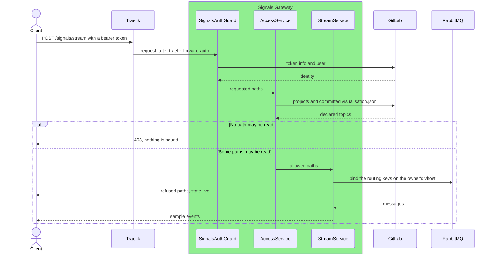

# Signals Gateway Microservice

The signals gateway serves the live and past signals of digital twins to the
DTaaS client. It reads RabbitMQ and InfluxDB with read-only service
credentials kept on the server, and serves each user only the signals that the
twins of that user declare in GitLab. The client reads it through
`REACT_APP_VIZ_SIGNALS_URL`, so no broker or InfluxDB credential reaches the
browser.

## Architecture and Design

The microservice is built with the NestJS framework, on the pattern of the
logger microservice. Every route is under `/signals`:

| Route | Answer |
| :--- | :--- |
| `GET /signals/health` | `{"status":"ok"}` |
| `POST /signals/stream` | Live samples as server-sent events |
| `POST /signals/range` | Past samples as JSON |

`stream` and `range` need the user's GitLab access token as a bearer token.
The decision of what a user may read sits behind the `AccessPolicy` interface
in `src/authz/policy.ts`, with `check(subject, action, resource)` and
`listResources(subject, action)`. `GitLabTwinPolicy` implements it from the
projects the user can read and their committed `visualisation.json` files, so
another policy engine can replace it. In the same way the `SignalBroker`
interface in `src/broker/broker.ts` hides RabbitMQ from the streams.

## Package Structure

```text
servers/signals/
├── src/
│   ├── main.ts                    # Entry point, reads --config
│   ├── app.module.ts              # Root module, the policy and broker providers
│   ├── signals.controller.ts      # The three routes
│   ├── socket-address-throttler.guard.ts  # Request rate limit per TCP peer
│   ├── auth/                      # Who the token belongs to
│   │   ├── auth.guard.ts          # SignalsAuthGuard: bearer token, forwarded user
│   │   ├── gitlab.client.ts       # Calls to the one configured GitLab
│   │   ├── identity.service.ts    # Token info and user, cached by hash
│   │   └── ttl-cache.ts
│   ├── authz/                     # What the user may read, deny by default
│   │   ├── policy.ts              # The AccessPolicy interface
│   │   ├── gitlab-twin.policy.ts  # Projects of the group the user can read
│   │   ├── twin-reader.ts         # Committed visualisation.json, by commit
│   │   ├── visualisation.ts       # Topics, channels and influx sources
│   │   └── access.service.ts      # One logged decision per requested path
│   ├── broker/                    # Live signals from RabbitMQ over AMQP
│   │   ├── broker.ts              # The SignalBroker interface
│   │   ├── amqp.broker.ts         # One connection per vhost
│   │   ├── vhost-link.ts          # One exclusive queue per connection
│   │   ├── binding-table.ts       # Bindings shared across streams
│   │   └── routing-key.ts         # MQTT topic to AMQP routing key
│   ├── history/                   # Past signals from InfluxDB 2
│   │   ├── flux.ts                # Fixed Flux text, values as params
│   │   ├── influx.client.ts
│   │   ├── annotated-csv.ts
│   │   └── history.service.ts     # Downsampling to the point budget
│   ├── stream/                    # Server-sent events
│   │   ├── stream.service.ts
│   │   ├── stream-session.ts
│   │   ├── stream-slots.ts        # Open streams per user
│   │   └── sse-writer.ts
│   ├── dto/requests.ts            # Request bodies and path validation
│   └── config/                    # One zod schema, secrets only as files
├── test/                          # unit, e2e and integration suites
└── config/signals.yaml.sample     # Every configuration key
```

## Sequence of a Live Stream



## Build and Test

Run from `servers/signals/`:

```bash
yarn build && yarn test && yarn test:int
```

`yarn test:int` starts `rabbitmq:4.2.8-management` in Docker, creates the
read-only service user, and checks that the user can neither publish nor
declare a queue outside its prefix. It is skipped when `docker info` fails.
The [admin pages](../../admin/servers/signals/config.md) describe the
configuration and the deployment.
