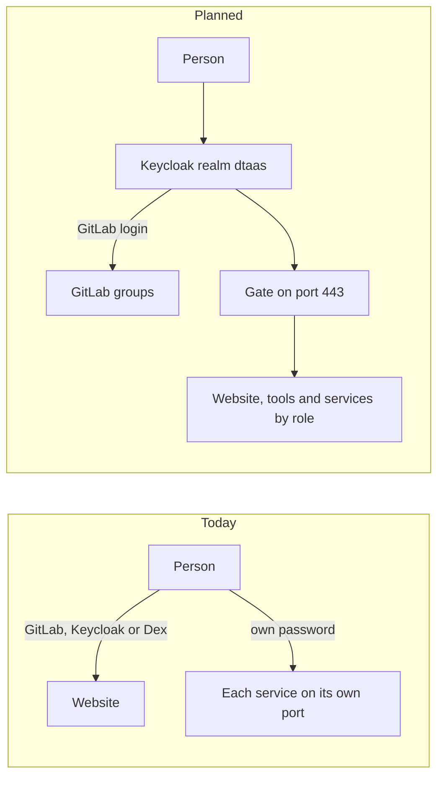

# Access and Single Sign-On Plan

This page plans how a person signs in to DTaaS once and receives, with that
one sign-in, every access they have: website pages, client extensions,
workspace tools, servers, platform services and data. It also plans how
the system's own credentials are kept and how access ends when a person
leaves or changes group. It is a plan for discussion. Nothing on this page
is implemented yet and each step becomes its own pull request.

The plan covers three layers, each compared below as it is today and as it
is planned:

1. People: sign-in, roles and what each person sees.
2. System credentials: the administrator passwords and tokens that the
   installation itself uses.
3. Devices and programs: sensors, Telegraf and CI jobs.

## Role-Based Access Control

The access model is role-based access control (RBAC): each person is
assigned one or more roles and each role carries the permissions of the
people in it
([NIST RBAC](https://csrc.nist.gov/projects/role-based-access-control)).
Here a person receives a role by being a member of a GitLab group at a
level. The roles are `<group>_viewer`, `<group>_member` and
`<group>_admin`, named as in the naming convention for the platform
services. One table maps each role to a permission in every component.

Two checks sit next to the roles and are not part of them:

- A workspace belongs to one person, so the gate also checks that the
  person is its owner or a member of its group.
- A new person or role starts with no access. Access is granted only by
  the table
  ([OWASP Authorization Cheat Sheet](https://cheatsheetseries.owasp.org/cheatsheets/Authorization_Cheat_Sheet.html)).

## Layer 1: People

| Topic        | Today                                                         | Planned                                                       |
| :----------- | :------------------------------------------------------------ | :------------------------------------------------------------ |
| Sign-in      | Website through GitLab, Keycloak or Dex. Each service has its own accounts and passwords | One sign-in through Keycloak, with GitLab as the login. No second password |
| Roles        | None. Each person owns a private space in each service        | RBAC by group, from one access table under version control   |
| What is shown | Every page and extension to every signed-in person           | Only what the person's roles allow. Each component checks again |
| Tokens       | Held in the browser                                           | Held by a website backend, short-lived, one audience each     |
| Gate         | `thomseddon/traefik-forward-auth:latest`, with no group rules | One maintained forward-auth proxy that checks the group       |
| Ports        | Each service listens on its own port                          | Port 443 for people, plus MQTT over TLS for devices           |

Today `dtaas-services user add` reads `config/credentials.csv` and makes
one account per person in each service. RabbitMQ gives that account
configure, write and read on its own virtual host. MongoDB gives
`readWrite` on its own database and PostgreSQL makes it the owner of its
own database. Two people of the same project cannot share a virtual host,
bucket or database without manual work by an administrator.

### The Access Table

| Component              | `<group>_viewer`       | `<group>_member`       | `<group>_admin`        |
| :--------------------- | :--------------------- | :--------------------- | :--------------------- |
| Website pages          | Library, Digital Twins | All pages of the group | All pages of the group |
| Client extensions      | View only              | Use                    | Use and configure      |
| Workspace tools        | None                   | Own workspace          | Own workspace          |
| GitLab group           | Reporter               | Developer              | Maintainer             |
| Grafana folder         | Viewer                 | Editor                 | Admin                  |
| ThingsBoard customer   | Read-only user         | Customer user          | Customer admin         |
| RabbitMQ vhost         | Read                   | Read and write         | Configure              |
| Databases of the group | Read                   | Read and write         | Owner                  |

The levels are a first proposal for the team to decide.

### How Each Component Trusts the Sign-In

| Component           | How it trusts the sign-in                                |
| :------------------ | :------------------------------------------------------- |
| Website pages       | Session held by a website backend                        |
| Client extensions   | Declared roles, calls carry the person's token           |
| Workspace tools     | The gate checks owner or group of the workspace          |
| Platform servers    | The gate and a token for that server                     |
| GitLab              | OpenID Connect sign-in through the provider              |
| Grafana             | Generic OAuth, roles from the token                      |
| ThingsBoard         | OAuth 2.0 with a custom mapper                           |
| RabbitMQ            | OAuth 2.0 plugin, the token as password                  |
| PostgreSQL          | OAuth with a validator module                            |
| InfluxDB, MongoDB   | Short-lived accounts made from the person's roles        |

- GitLab Free self-managed accepts Keycloak as an OpenID Connect provider
  ([GitLab OpenID Connect](https://docs.gitlab.com/administration/auth/oidc/)).
  GitLab's ID token carries only `groups_direct`
  ([GitLab as provider](https://docs.gitlab.com/integration/openid_connect_provider/)),
  so Keycloak reads the groups and puts the roles in its tokens.
- Grafana maps a claim to a role with `role_attribute_path`
  ([Grafana generic OAuth](https://grafana.com/docs/grafana/latest/setup-grafana/configure-access/configure-authentication/generic-oauth/)).
- ThingsBoard maps the token to a tenant, customer and user
  ([ThingsBoard OAuth 2.0](https://thingsboard.io/docs/user-guide/oauth-2-support/)).
- RabbitMQ reads permissions from the token scopes and maps roles to
  scopes with `scope_aliases`
  ([RabbitMQ OAuth 2.0](https://www.rabbitmq.com/docs/oauth2)).
- PostgreSQL 18 accepts OAuth bearer tokens through a validator module
  ([PostgreSQL OAuth](https://www.postgresql.org/docs/18/auth-oauth.html)).
- MongoDB has OpenID Connect only in Enterprise
  ([MongoDB OIDC](https://www.mongodb.com/docs/manual/core/oidc/security-oidc/))
  and the InfluxDB 2 OSS documentation describes none.

## Layer 2: System Credentials

| Topic              | Today                                                       | Planned                                                       |
| :----------------- | :---------------------------------------------------------- | :------------------------------------------------------------ |
| Administrator passwords | `config/services.env`, copied by hand from a template that ships with passwords filled in | Random passwords generated at installation |
| File permissions   | `services.env` keeps the mode of the copy. Tokens and changed passwords are written with mode 600 | Every secret file written with mode 600 |
| Containers         | Passwords passed as environment variables, readable with `docker inspect` | Compose secrets mounted as files, through `_FILE` variables where the image supports them |
| Commands           | `rabbitmqctl add_user` and `influx user create` receive the password as an argument | Passwords passed through standard input |
| Rotation           | `user reset-password` for ThingsBoard and GitLab only       | One `secret rotate` command per service                       |

Compose mounts each secret at `/run/secrets/<name>` and keeps it out of
the environment. The `_FILE` variables are a convention of some images,
such as the PostgreSQL image
([Docker Compose secrets](https://docs.docker.com/compose/how-tos/use-secrets/)).
Rotation is automated because manual rotation leads to mistakes
([OWASP Secrets Management Cheat Sheet](https://cheatsheetseries.owasp.org/cheatsheets/Secrets_Management_Cheat_Sheet.html)).

A secrets manager is not part of the first steps. OpenBao, the open fork
of HashiCorp Vault, could issue the short-lived database accounts of
layer 1, since its database engine creates accounts with a lease
([OpenBao databases](https://openbao.org/docs/secrets/databases/)). It is
one more service to run, with a seal key and snapshots to keep, so it is
listed as a decision.

## Layer 3: Devices and Programs

| Topic    | Today                                    | Planned                                                    |
| :------- | :--------------------------------------- | :--------------------------------------------------------- |
| Accounts | A person's account, made from the CSV   | Program accounts `<group>_<purpose>` that belong to the group |
| Secrets  | Kept wherever the site keeps them        | Mounted as files, never in images or repositories          |
| Tokens   | None                                     | Client credentials grant from Keycloak where the service accepts tokens |

## When a Person Joins, Leaves or Changes Group

The installation acts on every departure and transfer. It disables the
account within a period the operators set
([NIST SP 800-53 AC-2](https://www.stigviewer.com/controls/nist-800-53/AC-2)).

| Event                     | Today                                              | Planned                                                     |
| :------------------------ | :------------------------------------------------- | :---------------------------------------------------------- |
| Joins                     | A row in `credentials.csv`, then `user add`        | Added to a GitLab group at a level                          |
| Leaves                    | Accounts removed by hand in each service. No command exists | Blocked in GitLab or removed from the group. Tokens expire within minutes |
| Changes group             | No groups exist                                    | Moved to the new group. Roles change at the next token      |
| Partner with an end date  | No end date                                        | Membership with an expiry date                              |
| An administrator leaves   | Every administrator password stays known           | `secret rotate` for every service                           |

Signing out of Keycloak does not revoke access tokens already issued, so
they stay valid until they expire
([Keycloak sessions](https://docs.redhat.com/en/documentation/red_hat_build_of_keycloak/26.2/html/server_administration_guide/managing-user-sessions)).
Tokens therefore live for minutes. Resources belong to the group, so the
data stays when a person leaves.

## What Changes for Each Role

| Who                  | What changes                                                    |
| :------------------- | :-------------------------------------------------------------- |
| Operator             | Edits the access table and group memberships, runs `secret rotate` |
| Researcher           | Signs in once and sees only the pages, tools and services of their groups |
| Partner site         | Reaches the broker over MQTT with TLS on one port, with a program account |
| Device               | Uses a program account of its group, never a person's          |

## Steps

Each step is one pull request and can be reviewed on its own.

1. Generate random administrator passwords, write secret files with mode
   600, pass passwords through standard input and add `user remove`.
2. Mount the passwords as Compose secrets and add `secret rotate`.
3. Write the access table and the group and role names.
4. Pin the forward-auth image to a digest, or replace it with a
   maintained proxy that checks groups.
5. Add the Keycloak realm `dtaas` with GitLab as the login, in one test
   installation.
6. Sign in to GitLab, Grafana and ThingsBoard through Keycloak.
7. Add the access profile service and build the website menu, extension
   list, Workbench tools and services list from it.
8. Move the website tokens to a backend, with token exchange for calls to
   the servers
   ([Keycloak token exchange](https://www.keycloak.org/securing-apps/token-exchange)).
9. Sign in to RabbitMQ with tokens, for people and for MQTT and AMQP
   programs.
10. Sign in to PostgreSQL with tokens, after choosing a validator module.
11. Add short-lived accounts for InfluxDB and MongoDB.
12. Close every service port except 443 and MQTT over TLS.
13. Make signing out end the sessions in every component.

Steps 1 and 2 change no behaviour for people and need no decision below.

## Decisions

1. Keycloak in every installation, or only in multi-user ones?
2. GitLab as the login behind Keycloak, or GitLab alone?
3. Are `viewer`, `member` and `admin` the right levels, is the mapping
   right and who owns the access table?
4. A website backend that holds the tokens, which changes the React
   client?
5. Pin the current forward-auth proxy, or replace it with one that checks
   groups, such as oauth2-proxy?
6. Which PostgreSQL validator module is used and is it maintained?
7. What makes the short-lived InfluxDB and MongoDB accounts, a small
   service of DTaaS or OpenBao? How long do they last?
8. Closing every service port except 443 and MQTT over TLS changes how
   partner sites reach the broker. Is that acceptable?
9. Devices outside the network: separate MQTT accounts, or tokens with
   the client credentials grant?
10. How long may an account stay active after a person leaves?
11. The order of the steps.
