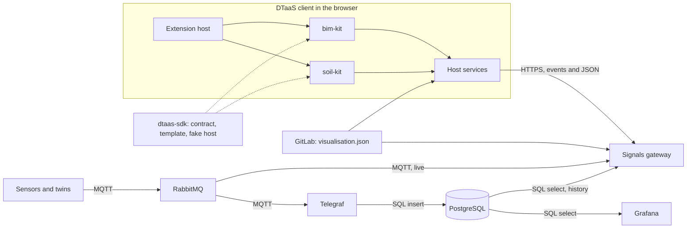

# Domain Kits: What the SDK Gives Every Extension

A domain kit is an extension package that brings one domain to DTaaS: its model,
its views and the bindings of its signals. `bim-kit` brings buildings. This page
plans what the extension SDK gives every kit, checks the current code against
published practice and works out a second kit, `soil-kit`, for a soil physical
twin at Aarhus University. Two kits of different domains on the same SDK,
gateway and history store are the test that the platform is general. The shape
of the Extension API itself is discussed in #1912. This page lists what a kit
needs from it.

## Architecture With Kits



- The data path is the one of the [signals gateway plan](signals-gateway.md) and
  is the same for every kit.
- A kit runs inside the extension host and reaches signals, history and the
  twin's `visualisation.json` only through the host services. It holds no
  credential.
- A kit owns its domain model, its anchor kinds, its substrates and, where it
  needs them, its own metadata tables.
- The SDK gives every kit the contract, a template and a fake host for tests. It
  is `dtaas-sdk` today. #1912 proposes the name `dtaas-extension-api` and
  decides it.

## What a Kit Is

A kit is an npm package with an entry `./dtaas` that exports one
`DtaasExtension`, as `bim-kit` does today. The domain core, the React components
and the converters of the package work without DTaaS.

| Part | `bim-kit` | `soil-kit` |
| :--- | :-------- | :--------- |
| Domain model | Building, storeys and spaces from IFC, objects by `GlobalId` | Site, profiles (stations) and sensors at depth ranges |
| Anchor kind | `ifc-guid` | `soil-depth`, a profile and a depth range |
| Substrate | `aec`, the 3D building | `soil-profile`, a depth chart and a time by depth heatmap |
| Converter | IFC to GLB | None, the profile is drawn from the `soil_sensor` table |
| Own tables | None | `soil_sensor`, the depth range of each sensor, keyed by `device_id` |
| Scopes | Room and storey | Profile and depth range |
| Signals | One quantity per device topic | The same, one quantity per depth |
| History, access, gateway | Shared | Shared |

## Requirements for the SDK

| ID | Requirement | Practice it follows |
| :- | :---------- | :------------------ |
| K1 | A kit declares the range of the SDK API it needs and the host refuses a kit outside it. | VS Code `engines`, Grafana `grafanaDependency` |
| K2 | Routes, menu items, tabs, substrates, anchor kinds and presets are declared, not registered by code. | VS Code `contributes`, Backstage extension blueprints |
| K3 | A kit's code loads only when one of its routes or views opens. | VS Code activation events |
| K4 | A kit receives host services (signals, history, visualisation, settings) and never a broker or database credential. | JupyterLab service tokens, Backstage `deps`, Grafana service account tokens |
| K5 | A kit may own its substrates and anchor kinds. | #1912, section 10.2 |
| K6 | A kit describes its things as a template with properties, actions and events, bound to signal paths. | W3C WoT Thing Model and Thing Description 1.1 |
| K7 | Observations follow one model in every kit: a platform hosts sensors, each signal is one sensor and one observed property. | W3C SOSA/SSN, OGC SensorThings API 1.1 |
| K8 | A new kit starts from a template and is tested against a fake host, with no running installation. | Grafana plugin tools, JupyterLab extension template |
| K9 | An operator chooses the installed kits in the deployment configuration, without editing the client source. | JupyterLab prebuilt extensions |
| K10 | A breaking change to the API is a new version of the extension point, never a silent change. | Backstage extension points |
| K11 | A kit may add its own metadata tables in the group database. They follow the naming convention and are keyed by `device_id`, so they join with `reading`, `device` and the tables of other kits. They never change the shared tables. | Naming convention, SensorThings API entities linked by identifier |
| K12 | A kit may offer a service to other kits through the host and use the service of another kit the same way, never by importing its code. | JupyterLab `provides` and `requires` tokens |

Sources: [VS Code
manifest](https://code.visualstudio.com/api/references/extension-manifest), [VS
Code activation
events](https://code.visualstudio.com/api/references/activation-events),
[Grafana
plugin.json](https://grafana.com/developers/plugin-tools/reference/plugin-json),
[Backstage
blueprints](https://backstage.io/docs/frontend-system/architecture/extension-blueprints),
[Backstage extension
points](https://backstage.io/docs/backend-system/architecture/extension-points),
[JupyterLab
extensions](https://jupyterlab.readthedocs.io/en/stable/extension/extension_dev.html),
[WoT Thing Description 1.1](https://www.w3.org/TR/wot-thing-description11/),
[SOSA/SSN](https://www.w3.org/TR/vocab-ssn/) and [SensorThings API
1.1](https://docs.ogc.org/is/18-088/18-088.html).

## The Current Code Against the Requirements

The code is the extension host of #1879 (`client/sdk` and
`client/src/extension`) and of the follow-up branch
`feat/aec-substrate-and-gateway-access` of the fork, which adds the `aec`
substrate.

| ID | Today | Gap |
| :- | :---- | :-- |
| K1 | `sdk: 1` in the extension, checked by the host | A major number only, no range |
| K2 | `routes`, `navigation`, `visualisation` are declared and mounted | `digitalTwinTabs` and `reducer` are collected and not mounted. `assetPreviews` is not collected |
| K3 | Pages are lazy imports | Met |
| K4 | `HostServices` gives `signals`, `viz`, `library`, `git`, `settings` and `config`. Signals come only through the gateway | `setup(host)` is never called |
| K5 | Kits may add substrates with new ids | `STANDARD_SUBSTRATES` reserves `image`, `aec`, `mesh`, `video`, `embed`, `geo` and `field` for the core and `aec` lives in the client core, so no kit owns a substrate yet. #1912 (section 10.2) places `aec` in `bim` and `geo` and `field` in their own extensions |
| K6 | An anchor is `{signalPath, kind, ref}` in `visualisation.json` | No thing template, so each kit invents its own model |
| K7 | Signals are scalar values on topic paths | No shared notion of platform, sensor or depth |
| K8 | `client/sdk/src/testing` has `fakeHostServices`, `fakeSignals` and `checkConformance`. `dtaas-sdk` has the example kits `hello-kit` and `bim` | No template or generator that starts a new kit |
| K9 | `const extensions = [bim]` in `client/src/extensions.ts`, plus `REACT_APP_EXTENSIONS_DISABLED` | Adding a kit needs a source edit and a rebuild |
| K10 | `visualisation.json` has `schemaVersion` | The contract package is private and not published. #1912 keeps it unpublished until a second extension is ported, which `soil-kit` would be |
| K11 | `dtaas-services` creates the shared databases | No way for a kit to bring its own migration |
| K12 | Host services are fixed by the host | No service that one kit offers to another |

The signals gateway and the history store already meet the needs of a second
domain. A topic is a signal path whatever the domain, the access rule reads the
paths a twin declares and `reading` holds one quantity of one device per row.
`soil-kit` needs no change to the gateway or to Telegraf.

## Soil-Kit

### Model

The soil twin is modelled in SOSA terms, aligned with the GloSIS soil ontology
and the INSPIRE soil profile.

| SOSA | Soil twin | Where it lives |
| :--- | :-------- | :------------- |
| Feature of interest | Site, then profile | Topic levels, the `device` and `soil_sensor` tables |
| Platform | Profile station | `area` topic level |
| Sensor | Probe at one depth range | `device_id` |
| Observable property | `soil_moisture`, `soil_temperature`, `electrical_conductivity`, `matric_potential` | `quantity` topic level |
| Observation | One reading | `reading` row |

The depth range is a property of the sensor, so it is stored once in the kit's
own table `soil_sensor` (K11), keyed by `device_id`, as `depth_from` and
`depth_to` in metres below the surface. These are the upper and lower depths of
the INSPIRE soil profile element, as the SoilWise GeoPackage implementation of
INSPIRE records them
([ProfileElement](https://soilwise-he.github.io/Geopackage-so/tables/profileelement.html)).
It never becomes part of a name, as the naming convention requires.

### Topic and Payload

The eight levels of the [naming convention](naming/messaging.md) carry a soil
reading without a new level:

| Level | Name | Example |
| :---- | :--- | :------ |
| 1 | `project` | `AUSoil` |
| 2 | `building` | The site, `Site1` |
| 3 | `level` | `field` |
| 4 | `unit_id` | The plot, `07` |
| 5 | `area` | The profile, `P03` |
| 6 | `device_type` | `S` |
| 7 | `device_id` | `S-AUSoil-Site1-field-07-P03-VWC-0001` |
| 8 | `quantity` | `soil_moisture` |

The devices are registered before they publish, as for every twin, so the
registration writes their `device` rows. The kit adds its `soil_sensor` rows
through a registration hook, which K-d adds for every kit.

Units are SenML codes on the wire, as the convention requires: `/` for
volumetric water content as a ratio, `Cel`, `S/m` and `Pa`. SenML has no `kPa`
and no `m3/m3`, so matric potential travels in pascal ([IANA SenML
units](https://www.iana.org/assignments/senml/senml.xhtml)).

### Views

- `soil-profile` substrate: the latest value at each depth of a profile, and a
  time by depth heatmap of one quantity, the two views that soil station portals
  show, such as the [Montana Mesonet soil
  profile](https://climate.umt.edu/mesonet/ag_tools/soil_profile/).
- The anchor kind `soil-depth` resolves a reference such as `P03/0.20-0.40`, a
  profile and a depth range in metres, to a row of the chart. An anchor
  reference is a string in the current schema.
- A map of the profiles needs a `geo` substrate, which #1912 places in its own
  extension. Until then the kit page lists the profiles.

```json
{
  "schemaVersion": "1.0",
  "name": "Site 1, plot 07",
  "domain": "soil",
  "layout": { "type": "single", "panes": ["profile"] },
  "substrates": { "profile": { "adapter": "soil-profile" } },
  "anchors": [
    {
      "signalPath": "AUSoil/Site1/field/07/P03/S/S-AUSoil-Site1-field-07-P03-VWC-0001/soil_moisture",
      "kind": "soil-depth",
      "ref": "P03/0.20-0.40"
    }
  ]
}
```

## Phases

The kit phases follow the increments of #1912 (section 14) and run next to the
gateway phases of the [execution plan](signals-gateway-execution.md). K-a is
part of the client pull requests Extension API core and web extension host
(#1912 steps 2 and 3). K-b is part of the visualisation pull request, which adds
the substrate registry (#1912 step 6). K-c is the fake host harness and template
of #1912 step 8. Steps 1, 4 and 7 of #1912 (the core extraction, the CI gates
and the CLI host) are outside this page.

| Phase | Work | Done when |
| :---- | :--- | :-------- |
| K-a | Close the gaps of K1, K2, K4, K10 and K12 in the contract: an API range, every declared point mounted, `setup` called, services between kits | A kit outside the range is refused and a kit tab appears on a twin page |
| K-b | `aec` moves from the client core into `bim-kit` and leaves `STANDARD_SUBSTRATES` (K5) | The client core has no building code and `bim-kit` works as before |
| K-c | A kit template built on the existing fake host and fake signals (K8) | A new kit builds and passes its tests with no installation |
| K-d | `soil-kit` from the template, with the `soil-profile` substrate, the `soil-depth` anchor and the `soil_sensor` migration run by `dtaas-services`, with the hook that lets every kit bring a migration and extend registration (K11). As the second ported extension, it is the trigger #1912 sets for publishing the contract | A soil reading shows in the profile chart, with no change to the client core, the gateway or Telegraf |
| K-e | Installed kits chosen in the deployment configuration (K9) | An operator adds `soil-kit` without editing `extensions.ts` |

Loading kits at runtime from a URL is a non-goal of #1912. If it is taken up
later, it needs a signed manifest with file checksums, an allow-list of kit
origins, Subresource Integrity and a Content Security Policy, as Grafana does
for plugins ([Grafana plugin
signing](https://grafana.com/developers/plugin-tools/publish-a-plugin/sign-a-plugin),
[Subresource
Integrity](https://developer.mozilla.org/en-US/docs/Web/Security/Subresource_Integrity)).

## Decided

1. Each kit may create its own metadata tables, as long as they follow the
   naming convention and join with the shared tables and the tables of other
   kits through `device_id` (K11).

## Open Questions

1. Which soil twin at Aarhus University is the first one, with which sensors,
   depths and protocol? The maintainer knows the site, so the kit starts from
   his answer.
2. Is the thing template of K6 a WoT Thing Model, or a smaller schema of the SDK
   that can be exported to one? This is for discussion. Ditto is not used, but
   its use of WoT Thing Models is one reference.
3. Do the topic levels `building`, `level` and `unit_id` keep their names for
   every domain, or get domain-neutral names such as `site` and `zone`?
4. Which substrate after `aec` is built first? Does it go in the core or in its
   own extension?
5. Are kits named `<domain>-kit`, as `bim-kit` is today, or
   `dtaas-ext-<domain>`, as #1912 proposes?
