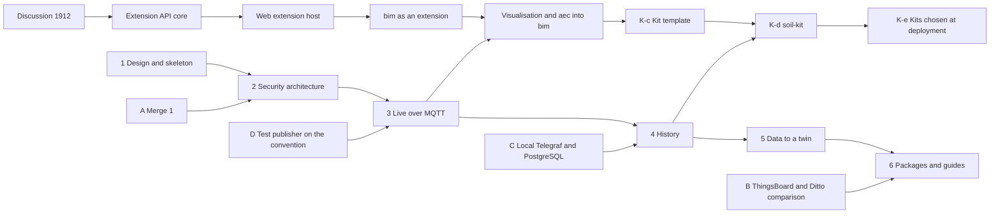

# Signals Gateway: Execution Plan

This page says how the [signals gateway plan](signals-gateway.md) is built: the
order of the work, where each piece of code comes from, what is written new and
how each phase is checked before review. The plan says what and why. This page
says how.

Code marked "from #1879" is in that pull request. Code marked "from the
follow-up branch" is in `feat/aec-substrate-and-gateway-access` of the fork
`jadypamella/DTaaS`, which extends #1879 and is not in a pull request.

## Order of the Work

## Rules for Every Phase

- One pull request at a time. A phase opens after the previous one is merged.
- Each branch starts from an up-to-date `feature/distributed-demo` and is named
  `<type>/<short-summary>`, as in the [naming
  convention](naming/applications.md).
- Names follow the [naming convention](naming/index.md): accounts in
  `snake_case` as `<group>_<purpose>`, `_ro` for read-only accounts, secret
  files as `<service>_<account>_password`, the table `reading` and indexes as
  `<table>_<columns>_idx`.
- Secrets follow the [access plan](access-plan.md): files with mode 600, never a
  command-line argument or an environment variable, TLS on every connection that
  leaves the Docker network, the fewest permissions an account needs,
  parameterised SQL and a decision log with no token and no sample.
- A new dependency or image is a version published at least ten days earlier,
  pinned exactly, as the `upgrade-npm-packages` skill of this repository
  requires. `yarn audit` is compared against the base branch.
- Before review: `yarn build`, `yarn test` and, where present, `yarn test:int`
  in `servers/signals`, the repository linters, markdownlint on every changed
  page and clean SonarQube, Codecov and Qlty reports. Pages made stale by the
  change are updated in the same pull request.
- When a phase changes a choice of the plan, the plan changes in the same pull
  request.

## Preparation

| Step | Work | Done when |
| :--- | :--- | :--- |
| A | Merge this pull request | Merged |
| B | A documentation page that compares Telegraf with the gateway, ThingsBoard and Eclipse Ditto, with a source for each row: licence, ingest from an external broker, history store, history API, live events to a browser, access control and configuration schema. Apache NiFi, Node-RED and Apache Airflow are checked for overlap | The page is in the guides of phase 6 |
| C | Telegraf and PostgreSQL in a local test installation, with the `reading` and `device` tables of the naming convention | A reading of a registered device is in `reading` |
| D | Test publishers move to the topic and payload of the naming convention: eight topic levels and a JSON payload with `value`, `ts` and `unit`. The room 02-24 test publisher sends seven levels and CSV today | The test publisher follows the convention |

## Phase 2: Security Architecture

- **Branch:** `feat/signals-security`.
- **First, a mapping page** in `docs/developer/plans/`:
  - The claims, roles and attributes of each provider. GitLab gives
    `groups_direct` in the ID token and `groups` and the owner, maintainer and
    developer claims only from userinfo, for direct membership only. Keycloak
    gives realm and client roles and gives groups through a mapper. Dex gives
    `groups`. Its GitLab connector can add the role to each group.
  - How the access table of the access plan maps onto each provider and onto
    each service, as the maintainer asked.
  - The Traefik glue: ForwardAuth with a maintained proxy such as oauth2-proxy
    with its Keycloak provider, compared with the current
    `thomseddon/traefik-forward-auth`.
  - The standards the design is checked against: RFC 9700, RFC 9068, RFC 10017,
    OWASP ASVS 5.0 and NIST SP 800-162 for attribute-based access control.
- **From #1879:** `src/auth/` (`auth.guard.ts`, `identity.service.ts`,
  `gitlab.client.ts` and `ttl-cache.ts`), `socket-address-throttler.guard.ts`,
  `cors.ts` and `startup-warnings.ts` from `src/config/`, `dto/requests.ts`, the
  topic check of `broker/routing-key.ts` as `src/topic.ts`, `config/secrets.ts`
  and their unit tests.
- **From the follow-up branch:** `src/authz/` (`access.service.ts`,
  `policy.ts`, `gitlab-twin.policy.ts`, `twin-reader.ts`, `visualisation.ts` and
  `contract.schema.ts`) with the unit test `declaration-scope`. The vhost and
  InfluxDB fields are left out, since phases 3 and 4 replace them.
- **New:**
  - GitLab tokens are introspected, as #1879 does.
  - Keycloak and Dex JWTs are checked for signature, expiry, issuer and an
    audience that names the gateway, with the `jose` library.
  - The groups of a Keycloak or Dex token name the projects the user reads.
    Their twins are read with the gateway's own GitLab token, from
    `gitlab-token-file`. Secrets come only from files.
- The `stream` and `range` routes still answer 501, behind the sign-in and the
  access policy. The decision log records the user, the paths and the result.
- **Done when:** the mapping page is reviewed and for each provider the tests
  refuse a token issued to another application or audience, an expired token and
  an undeclared path and accept a declared path of a readable project.

## Phase 3: Live Samples Over MQTT

- **Branch:** `feat/signals-live-mqtt`.
- **From #1879:** `stream.service.ts`, `stream-session.ts`, `stream-slots.ts`
  and `sse-writer.ts` from `src/stream/`, the `Broker` interface in
  `broker/broker.ts` with `binding-table.ts` and `routing-key.ts`, the unit
  tests `stream`, `broker` and `routing-key` and the test helpers `fake-broker`
  and `sse-client`.
- **From the follow-up branch:** `stream/delivery-stats.ts` and the unit test
  `revocation`.
- **Left out:** `amqp.broker.ts`, `vhost-link.ts`, the `fake-amqp` helper and
  the `amqplib` dependency. AMQP stays in Left for Later.
- **New:** `mqtt.broker.ts` behind the same `Broker` interface, built on the
  `mqtt` library. One connection per instance with the client ID
  `dtaas_signals_<host>`, one subscription per path that an open stream asks for
  and QoS 0. A message outside the payload convention or above
  `max-message-bytes` is dropped and counted.
- **Configuration:** `rabbitmq-user` becomes `dtaas_signals`, a new `mqtt-url`
  uses `mqtts://` outside the Docker network and the password is read from
  `/run/secrets/rabbitmq_dtaas_signals_password`.
- **`dtaas-services`:** `user add-signals` makes `dtaas_signals` with topic
  permissions in the virtual host `/`, read on the prefixes of the projects
  served and write only on `.../cmd/`. Its InfluxDB part is removed. Tests use
  Click's `CliRunner`.
- **Integration test:** `rabbitmq.int.spec.ts` is rewritten for MQTT, against
  `rabbitmq:4.4.0-management` with the MQTT plugin.
- **Done when:** a reading published by a test device reaches a browser stream
  in a local installation. A path of another group is refused.

## Phase 4: History

- **Branch:** `feat/signals-history-postgres`.
- **From #1879:** `history/history.service.ts` and its unit test. It keeps the
  limits of seven days and 10000 points.
- **Left out:** `flux.ts`, `annotated-csv.ts`, `influx.client.ts`, their tests
  and the `influx-*` configuration keys.
- **New in the gateway:** `postgres.client.ts` on the `pg` library, with
  parameterised queries, downsampling with `date_bin` and one connection pool
  per group database. The keys `postgres-url`, `postgres-user`
  (`dtaas_signals_ro`), `postgres-password-file` and
  `postgres-database-template` (`{group}`), so a path is read from the database
  of the group that owns the twin declaring it.
- **New in `dtaas-services`:**
  - A migration that creates `device`, `reading` and
    `reading_device_id_time_idx` in each group database.
  - The roles `<group>_telegraf` (insert into `reading`), `dtaas_signals_ro` and
    `<group>_view_ro` (select).
  - A command that registers a twin: it writes the `device` rows, then the
    twin's Telegraf file after `telegraf config check` passes. A command that
    removes a twin deletes the file and its MQTT session queue. A twin belongs
    to one group, so its client ID is unique.
  - A Telegraf service pinned to 1.40.2 or a later release older than ten days,
    started with `--config-directory` and `--watch-config notify`.
  - The Grafana data source `postgresql_<group>`, provisioned from a file.
- **The twin's Telegraf file:** `inputs.mqtt_consumer` with `topic_parsing` on
  the twin's topic prefix, a `tagdrop` for status topics, the JSON v2 parser
  with `timestamp_format = "rfc3339"` and `timestamp_timezone = "UTC"`,
  `name_override = "reading"`, QoS 1, a persistent session and a routing tag.
  The input has a `tagpass` on the registered `device_id` values and
  `outputs.postgresql` a `tagpass` on the routing tag, because Telegraf joins
  the tag keys of one `tagpass` with OR
  ([Telegraf configuration](https://github.com/influxdata/telegraf/blob/v1.40.2/docs/CONFIGURATION.md)).
  The output has `taginclude = ["device_id", "quantity", "unit"]`, empty
  `create_templates` and `add_column_templates` and its password from
  `secretstores.docker`. An insert-only role is enough, since the output writes
  with COPY.
- **Done when:** the reading published in phase 3 is returned by `range` and
  shown in Grafana and a reading of an unregistered device is not stored.

## Phase 5: Data to a Twin

- **Branch:** `feat/signals-command`.
- **From #1879:** nothing. #1879 sends no data to a twin.
- **New:** `POST /signals/command`, which publishes to `.../cmd/<command>` with
  the payload of the convention. It needs the `member` level, read from the
  provider as phase 2 maps it.
- **Done when:** a set point reaches a test twin and a `viewer` is refused.

## Phase 6: Packages and Guides

- **Branch:** `docs/signals-packages`.
- **From #1879:** `docs/admin/servers/signals/` (`config.md`, `docker.md` and
  `service-users.md`), rewritten for MQTT and PostgreSQL. The four docker
  packages also come from #1879. The comparison page of step B joins the guides.
- **Done when:** a new installation that follows only the guides streams, stores
  and shows a reading.

The client pull requests and the kit phases are on the [domain
kits](domain-kits.md) page.

## Risks

| Risk | Response |
| :--- | :--- |
| Devices publish outside the convention | Step D before phase 3 |
| A reading of an unregistered device loses its batch | Registration writes the device before the Telegraf file. A test in phase 4 |
| A malformed Telegraf file stops all ingestion on reload | One template tested in CI and `telegraf config check` before the file is written |
| Many twins mean many reloads of one agent | Persistent sessions keep the readings. Files per domain or user if reloads become a problem |
| A library has no version older than ten days | The newest older version, stated in the pull request |
| The plan and the code drift apart | Each phase updates the plan when a choice changes |

## Choices Made in the Code

These choices were made while the phases were implemented and are recorded
here so that the plan and the code agree.

- **Two MQTT connections.** The gateway opens one connection for samples,
  with the client id `dtaas_signals_<host>_stream`, and one for commands,
  with `dtaas_signals_<host>_command`. RabbitMQ closes a connection that
  publishes where it may not, so a refused command cannot end the live
  streams of every user.
- **QoS.** Samples are subscribed with QoS 0, as phase 3 plans. Commands are
  published with QoS 1, so the gateway answers `202` only once the broker has
  taken the command, and `504` after `command-timeout`.
- **The `setpoint` channel.** A path takes a command only when it is an
  actuator topic of eight levels, with `A` as its sixth level, and a twin
  declares it on the `setpoint` channel. The command goes to the device topic
  with `cmd/<command>` in place of the quantity. A path declared only to be
  read takes no command.
