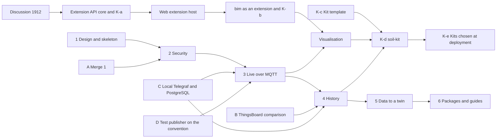

# Signals Gateway: Execution Plan

This page says how the [signals gateway plan](signals-gateway.md) is built:
the order of the work, where each piece of code comes from, what is written
new and how each phase is checked before review. The plan says what and why.
This page says how.

## Order of the Work

## Rules for Every Phase

- One pull request at a time. A phase opens after the previous one is
  merged.
- Each branch starts from an up-to-date `feature/distributed-demo` and is
  named `<type>/<short-summary>`, as in the
  [naming convention](naming/applications.md).
- Names follow the [naming convention](naming/index.md): accounts in
  `snake_case` as `<group>_<purpose>`, `_ro` for read-only accounts, secret
  files as `<service>_<account>_password`, the table `reading` and indexes
  as `<table>_<columns>_idx`.
- Secrets follow the [access plan](access-plan.md): files with mode 600,
  never a command-line argument or an environment variable, TLS on every
  connection that leaves the Docker network, the fewest permissions an
  account needs, parameterised SQL and a decision log with no token and no
  sample.
- A new dependency is a version published at least ten days earlier,
  pinned exactly, as the `upgrade-npm-packages` skill of this repository
  requires. `yarn audit` is compared against the base branch.
- Before review: `yarn build`, `yarn test` and, where present,
  `yarn test:int` in `servers/signals`, the repository linters,
  markdownlint on every changed page and clean SonarQube, Codecov and Qlty
  reports. Pages made stale by the change are updated in the same pull
  request.
- When a phase changes a choice of the plan, the plan changes in the same
  pull request.

## Before Phase 2

| Step | Work | Done when |
| :--- | :--- | :--- |
| A | Merge this pull request | Merged |
| B | A feature comparison of Telegraf with the gateway against ThingsBoard and Eclipse Ditto, with a source for each row: licence, ingest from an external broker, history store, history API, live events to a browser, access control, configuration schema, cost of running it. Apache NiFi, Node-RED and Apache Airflow, named in the review of this plan, are checked for overlap | Shared with the maintainer. It answers open question 1 of the plan and says whether Ditto can serve the gateway's role |
| C | Telegraf and PostgreSQL in a local test installation, with the `reading` table of the naming convention | A reading published over MQTT is in `reading` |
| D | Test publishers move to the topic and payload of the naming convention: eight topic levels and a JSON payload with `value`, `ts` and `unit`. The room 02-24 test publisher sends seven levels and CSV today | The test publisher follows the convention |

## Phase 2: Security Framework

- **Branch:** `feat/signals-security`.
- **From #1879:**
  - `src/auth/`: `auth.guard.ts`, `identity.service.ts`, `gitlab.client.ts` and
    `ttl-cache.ts`.
  - `src/authz/`: `access.service.ts`, `policy.ts`, `gitlab-twin.policy.ts`,
    `twin-reader.ts`, `visualisation.ts` and `contract.schema.ts`.
  - `socket-address-throttler.guard.ts`.
  - From `src/config/`: `secrets.ts`, `startup-warnings.ts` and `cors.ts`.
  - `dto/requests.ts`.
  - The unit tests of each of these files.
- **New:** token validation through OpenID Connect discovery and the provider's
  published keys, a check of the `aud` or client id and a stop at startup when
  the client id is empty. This likely needs the `jose` library.
- The `stream` and `range` routes still answer 501, behind the sign-in and the
  access policy. The decision log records the user, the paths and the result.
- **Done when:** tests refuse a token of another application, an expired token
  and an undeclared path. They accept a path declared in a committed
  `visualisation.json` of a project the person can read.

## Phase 3: Live Samples Over MQTT

- **Branch:** `feat/signals-live-mqtt`.
- **From #1879:**
  - `src/stream/`: `stream.service.ts`, `stream-session.ts`, `stream-slots.ts`,
    `sse-writer.ts` and `delivery-stats.ts`.
  - The `Broker` interface in `broker/broker.ts`, with `binding-table.ts` and
    `routing-key.ts`.
  - The unit tests `stream`, `broker`, `routing-key` and `revocation`.
  - The test helpers `fake-broker` and `sse-client`.
- **Left out:** `amqp.broker.ts`, `vhost-link.ts`, the `fake-amqp` helper and
  the `amqplib` dependency. AMQP stays in Left for Later.
- **New:** `mqtt.broker.ts` behind the same `Broker` interface, built on the
  `mqtt` library.
  - One connection per instance, with the client ID `dtaas_signals_<host>`.
  - One subscription per path that an open stream asks for, at QoS 0.
  - A message outside the payload convention or above `max-message-bytes` is
    dropped and counted.
- **Configuration:**
  - `rabbitmq-user` becomes `dtaas_signals`.
  - A new `mqtt-url`, with `mqtts://` outside the Docker network.
  - The password is read from `/run/secrets/rabbitmq_dtaas_signals_password`.
- **`dtaas-services`:**
  - `user add-signals` from #1879 makes `dtaas_signals` with topic permissions
    in the virtual host `/`. It may read the prefixes of the projects served and
    write only `.../cmd/`.
  - The InfluxDB token part is removed.
  - Tests use Click's `CliRunner`.
- **Integration test:** `rabbitmq.int.spec.ts` is rewritten for MQTT, against
  `rabbitmq:4.4.0-management` with the MQTT plugin.
- **Done when:** a reading published by a test device reaches a browser stream
  in a local installation. A path of another group is refused.

## Phase 4: History

- **Branch:** `feat/signals-history-postgres`.
- **From #1879:** `history/history.service.ts`, with its limits of seven days
  and 10000 points and its unit test.
- **Left out:** `flux.ts`, `annotated-csv.ts`, `influx.client.ts`, their tests
  and the `influx-*` configuration keys.
- **New:**
  - `postgres.client.ts`, on the `pg` library, with parameterised queries only
    and downsampling with `date_bin`.
  - The keys `postgres-url`, `postgres-user` (`dtaas_signals_ro`) and
    `postgres-password-file`.
- **`dtaas-services`:**
  - A migration that creates `device`, `reading` and
    `reading_device_id_time_idx` in each group database, as on the [databases
    page](naming/databases.md).
  - The roles `<group>_ingest` (insert only), `dtaas_signals_ro` and
    `<group>_view_ro` (select only).
  - A Telegraf service, with its image pinned to an exact version of 1.27 or
    later.
  - Its `telegraf.conf` reads with `inputs.mqtt_consumer` (`topic_parsing`, the
    JSON v2 parser, `name_override = "reading"`, QoS 1 and a persistent
    session).
  - It writes with `outputs.postgresql`, which reads its password through
    `secretstores.docker`.
  - The Grafana data source `postgresql_<group>`, provisioned from a file.
- **Needs** the answers to open questions 2 to 4 of the plan. Without them, the
  phase starts with no foreign key and one Telegraf per installation and the
  pull request says so.
- **To check in practice:** that an insert-only role is enough for
  `outputs.postgresql` when the table already exists. The Telegraf documentation
  does not state the privileges it needs.
- **Done when:** the reading published in phase 3 is returned by `range` and
  shown in Grafana.

## Phase 5: Data to a Twin

- **Branch:** `feat/signals-command`.
- **From #1879:** nothing. #1879 sends no data to a twin.
- **New:** `POST /signals/command`.
  - It publishes to `.../cmd/<command>`, with the payload of the convention.
  - It needs the `member` level. Until the Keycloak realm of the access plan
    exists, the policy reads that level from GitLab (Developer or above on the
    project).
- **Done when:** a set point reaches a test twin and a `viewer` is refused.

## Phase 6: Packages and Guides

- **Branch:** `docs/signals-packages`.
- **From #1879:** `docs/admin/servers/signals/` (`config.md`, `docker.md` and
  `service-users.md`), rewritten for MQTT and PostgreSQL. The four docker
  packages also come from #1879.
- **Done when:** a new installation that follows only the guides streams, stores
  and shows a reading.

The four client pull requests (Extension API core, web extension host,
`bim` as an extension and visualisation) wait for discussion #1912. The
visualisation pull request reads signals after phase 3.
The kit phases are on the [domain kits](domain-kits.md) page.

## Risks

| Risk | Response |
| :--- | :--- |
| Devices publish outside the convention | Step D before phase 3 |
| ThingsBoard is chosen to own the history | The comparison of step B comes before phase 4 |
| The foreign key on `reading.device_id` blocks Telegraf | An explicit test in phase 4 |
| A library has no version older than ten days | The newest older version, stated in the pull request |
| The plan and the code drift apart | Each phase updates the plan when a choice changes |
