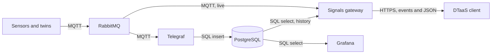

# Signals Gateway: Requirements, Architecture and Phases

This plan opens the first of the pull requests that split #1879. It states
who needs the signals of a digital twin, what the platform must guarantee to
each of them, the architecture agreed with the maintainer on 6 November 2026
and the phases in which it is built. Names follow the
[naming convention](naming/index.md) and access follows the
[access plan](access-plan.md).

## Architecture

- Live samples go from RabbitMQ to the gateway and from the gateway to the
  browser. They never pass through a database, because reading live data
  from a database means polling it.
- Telegraf is the only program that writes history. Its MQTT consumer input
  reads the readings and its PostgreSQL output, available since Telegraf
  1.24, writes them
  ([Telegraf PostgreSQL output](https://docs.influxdata.com/telegraf/v1/output-plugins/postgresql/)).
- The gateway reads history from PostgreSQL with a role that may only
  select. Grafana reads the same tables directly.
- No program written for one site sits in the data path. Telegraf and the
  gateway are configured, not extended.

## Phases

Each phase is one pull request with its tests and the documentation it
touches. It starts after the previous one is merged and passes the
repository checks (lint, tests, SonarQube, Codecov and Qlty) before review.
The [execution plan](signals-gateway-execution.md) lists the code each
phase takes from #1879, the new code and the checks.

| Phase | Pull request | Content | Done when |
| :---- | :----------- | :------ | :-------- |
| 1 | Design and skeleton | This plan, `servers/signals` with its configuration, the health route, `stream` and `range` routes that answer 501, the Docker image and the workflow that publishes the package and the image | The image answers 200 on health and 501 on the other routes |
| 2 | Security framework | Sign-in through OpenID Connect, `AccessPolicy` over the committed `visualisation.json`, rate limits and the decision log | A token of another application, an expired token and an undeclared path are refused in tests |
| 3 | Live samples over MQTT | MQTT subscription in the virtual host `/`, `POST /signals/stream` as server-sent events, the account `dtaas_signals` with topic permissions, made by `dtaas-services` | A reading published by a test device reaches a browser stream and a path of another group is refused |
| 4 | History | Telegraf, the `reading` and `device` tables, the PostgreSQL roles, `POST /signals/range` and the Grafana data source | A reading published in phase 3 is returned by `range` and shown in Grafana |
| 5 | Data to a twin | `POST /signals/command`, published to `.../cmd/<command>` for a person with the `member` role | A set point reaches a test twin and a `viewer` is refused |
| 6 | Packages and guides | The four docker packages, the administrator pages and the user guide | A fresh installation streams, stores and shows a reading |

Phase 3 takes the stream code of #1879 and replaces its AMQP reader with an
MQTT reader. Phase 4 replaces the InfluxDB reader of #1879 with a
PostgreSQL reader.

The client parts follow discussion #1912 on the Extension API and wait for
its decisions on the name and place of the contract.

| Order | Pull request | Content taken from #1879 |
| :---- | :----------- | :----------------------- |
| 1 | Extension API core | The contract now in `client/sdk` |
| 2 | Web extension host | Host services, extension registration in `extensions.ts`, menu, routes and the credentials held in the client core |
| 3 | `bim` as an extension | The Buildings page moved out of the client into its own package |
| 4 | Visualisation | The common core, the Visualise tab and the `image` and `embed` substrates, reading signals through the gateway after phase 3 |

## Who Reads and Writes Signals

| Who | Where it runs | What it needs |
| :-- | :------------ | :------------ |
| A client extension, for example `bim` | The user's browser | Read live and past signals of the twins the user can read and send data to the twins the user can write to |
| A digital twin in a workspace | A container on the DTaaS server | Read and write signals of its own group, with low delay |
| A digital twin started by a GitLab runner | A remote machine | Read and write signals of its own group |
| A device or an external system, such as the NTU sensors of room 02-24 | A partner's network | Write the signals of one project only |
| Grafana | The DTaaS server | Read the history of its users' groups, directly from PostgreSQL |
| ThingsBoard | The DTaaS server | Its own telemetry, in its own database |

## Requirements

| ID | Requirement |
| :- | :---------- |
| G1 | The browser holds no credential of RabbitMQ, MQTT or PostgreSQL. |
| G2 | A person reads and writes only the signals of twins that person may read or write, decided on the server. |
| G3 | A program that runs on a server or a runner reaches the services with the standard protocols and client libraries, without the gateway in its path. |
| G4 | Every credential is scoped to one project or group. |
| G5 | The sign-in works with GitLab, Keycloak and Dex, the providers DTaaS installations use today. |
| G6 | The access decision sits behind one interface, so the rule can change without changing the API. |
| G7 | A person who leaves a group loses access at the next check, with no account to delete by hand in each service. |
| G8 | The browser and the gateway read the same `visualisation.json`, so the page never asks for a path the gateway refuses. |
| G9 | Every extension uses the same gateway and an extension may add its own backend where the common one does not fit. |
| G10 | The gateway gives one interface over the data services, so a client extension needs no RabbitMQ, MQTT or PostgreSQL library. |
| G11 | History has one writer, Telegraf. Live samples never pass through a database. |
| G12 | Every account has only the permissions its purpose needs and every secret is a file. |
| G13 | Every name follows the naming convention. |

## Choices

### Browser Through the Gateway, Programs Directly (G1, G3, G10)

The browser reaches signals only through the gateway, in both directions.
Programs on the server, on a runner or at a partner connect to RabbitMQ and
MQTT directly, with their own scoped credential. A program needs to write,
needs low delay and already has client libraries for these protocols, so
putting the gateway in its path adds a hop and a single point of failure
without adding protection.

### Dashboards Read the Services Directly

Grafana reads PostgreSQL directly, through a data source per group with a
read-only role. ThingsBoard keeps its telemetry in its own database. Only
the data exchanged between the client and the twins goes through the
gateway.

### Live Samples Over MQTT (Phase 3, G11)

The broker sends all MQTT traffic through the virtual host `/`, as the
naming convention decided, so the gateway subscribes there. It holds one
connection per instance, with the client ID `dtaas_signals_<host>`. It
makes one subscription per path that any open stream asks for. Live samples use
QoS 0, since a sample lost during a reconnect is still in the history. A
message is forwarded only when it carries the fields `value`, `ts` and
`unit` of the payload convention and fits `max-message-bytes`. Every other
message is dropped and counted in `stats`.

### History Through Telegraf (Phase 4, G11)

- The MQTT consumer input subscribes with the account `dtaas_telegraf`,
  QoS 1, a fixed client ID and a persistent session, so the broker keeps
  the readings that arrive while Telegraf restarts
  ([Telegraf MQTT consumer](https://docs.influxdata.com/telegraf/v1/input-plugins/mqtt_consumer/)).
- `topic_parsing` turns the eight topic levels into tags with the names of
  the naming convention. The JSON v2 parser reads `value` as the field,
  `unit` as a tag and `ts` as the time. `name_override` sets the table name
  to `reading`.
- The tables `reading` and `device` and the index
  `reading_device_id_time_idx` are created by `dtaas-services` in the
  database of each group, as on the [databases page](naming/databases.md).
  Telegraf keeps only the tags that are columns of `reading` and its role
  may only insert, so it never creates or alters a table.
- The gateway's `range` route reads with parameterised queries, keeps the
  limits of #1879 (seven days and 10000 points per answer) and downsamples
  a longer series with `date_bin`.

### One Common Gateway, Extension Backends Allowed (G9)

There is one signals gateway for all extensions, as the first common
platform service. An extension that needs something the gateway does not
serve may add its own backend later. Discussion #1912 lists server-side
extensions as a non-goal, so this waits for a decision there. A gateway per
extension is not the default, because it would repeat the sign-in and
access code in each one.

### Sign-In Through OpenID Connect (G5)

In #1879 the gateway asks GitLab who owns a token. Phase 2 keeps that
behind the identity interface and adds token validation through OpenID
Connect discovery and the provider's published keys, so Keycloak and Dex
work the same way. The token must be issued to the DTaaS client
application (its `aud` or client id) and an empty client id stops the
service at startup.

### Access by Group Role (G2, G6, G7)

In #1879 a path is allowed when a `visualisation.json` committed in a
GitLab project the person can read declares it. That rule stays as the
first policy behind `AccessPolicy`. The next policy reads the group roles
of the access plan (`<group>_viewer`, `<group>_member`, `<group>_admin`).
Both are checked on every request against a cache of at most 60 seconds,
so removing a person from a group takes effect within a minute. Sending
data to a twin needs `member`.

### One Source of `visualisation.json` (G8)

The client reads the copy committed in GitLab, which is the one the gateway
reads. The page shows which paths were refused.

### API Style (G10)

Live samples go out as server-sent events, past samples as JSON over HTTP
and data sent to a twin as a JSON request. Server-sent events pass through
Traefik and proxies as ordinary HTTP. The stream request carries its list
of paths in the body, so the client reads it with `fetch` and reconnects
itself, since the browser's `EventSource` only sends GET requests. The
transport sits behind one service, so it can change without changing the
extensions.

## Accounts, Names and Secrets (G4, G12, G13)

| Account | Service | May | Secret file |
| :------ | :------ | :-- | :---------- |
| `dtaas_signals` | RabbitMQ, MQTT in `/` | Read the topics of the projects served, write only `.../cmd/<command>` | `rabbitmq_dtaas_signals_password` |
| `dtaas_telegraf` | RabbitMQ, MQTT in `/` | Read the topics of the projects served | `rabbitmq_dtaas_telegraf_password` |
| `<group>_ingest` | PostgreSQL, database `<group>` | Insert into `reading` | `postgresql_<group>_ingest_password` |
| `dtaas_signals_ro` | PostgreSQL, every group database | Select from `reading` and `device` | `postgresql_dtaas_signals_ro_password` |
| `<group>_view_ro` | PostgreSQL, database `<group>` | Select, for the Grafana data source `postgresql_<group>` | `postgresql_<group>_view_ro_password` |
| Device or partner | RabbitMQ, MQTT in `/` | Write the topics of one project | Kept by the site |

The gateway's accounts are the exception to G4, because they serve every
user. Their access is limited as above and every request is checked
against the person's own rights first.

- `dtaas-services` makes the accounts with random passwords, passed through
  standard input and written with mode 600, as in steps 1 and 2 of the
  access plan.
- Containers read secrets as Compose secrets under `/run/secrets`. The
  gateway reads them through its `*-password-file` keys and refuses a plain
  password at startup. Telegraf reads them through its Docker secret store,
  available since Telegraf 1.27.
- MQTT and PostgreSQL use TLS on every connection that leaves the Docker
  network.
- Images are pinned to an exact version. The decision log records the user,
  the paths and the result, never a token or a sample.

| Credential for a program | Kept where |
| :----------------------- | :--------- |
| Twin in a workspace | The group's broker account, mounted as a file |
| Twin on a GitLab runner | The group's broker account in a masked and protected CI/CD variable |

## Decided in Review

1. Virtual hosts separate the data flows of users. MQTT stays in `/` with
   topic permissions per project.
2. Dashboards read the services directly. Only the data exchanged in both
   directions between the client and the twins goes through the gateway.
3. A runner uses a CI/CD variable for now.
4. Live samples come from RabbitMQ through the gateway. Telegraf writes the
   history to PostgreSQL and the gateway reads it from there.
5. The first API phase streams MQTT readings only.

## Open Questions

1. ThingsBoard keeps its own PostgreSQL database. Does its telemetry also
   reach `reading`, or does ThingsBoard take the place of Telegraf? The
   feature comparison with ThingsBoard answers this.
2. The foreign key `reading_device_id_fkey` makes Telegraf retry a whole
   batch when one device is not yet in `device`. Is a device registered
   before it publishes, or is the key left out?
3. One Telegraf per installation, or one per group?
4. How long is raw history kept? Is TimescaleDB used for it?

## Left for Later

- A runner's job could sign in to RabbitMQ with its GitLab ID token through
  the RabbitMQ OAuth 2.0 plugin, so the credential ends with the job.
- Live samples over AMQP, for twins that publish to a virtual host of
  their own.
