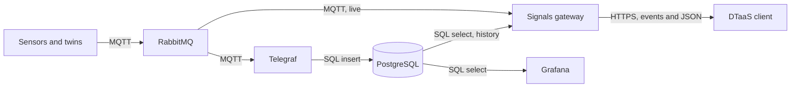

# Signals Gateway: Requirements, Architecture and Phases

This plan opens the first of the pull requests that split #1879. It states who
needs the signals of a digital twin, what the platform must guarantee to each of
them, the architecture agreed with the maintainer on 6 November 2026 and the
phases in which it is built. Names follow the [naming
convention](naming/index.md) and access follows the [access
plan](access-plan.md).

## Architecture

- Live samples go from RabbitMQ to the gateway and from the gateway to the
  browser. They never pass through a database, because reading live data from a
  database means polling it.
- Telegraf is the only program that writes history. Its MQTT consumer input
  reads the readings and its PostgreSQL output, available since Telegraf 1.24,
  writes them ([Telegraf PostgreSQL
  output](https://docs.influxdata.com/telegraf/v1/output-plugins/postgresql/)).
- The history of a signal lives in the database of the GitLab group that owns
  the twin declaring it. The gateway reads it there with a role that may only
  select. Grafana reads the same tables directly.
- ThingsBoard keeps its own PostgreSQL database. DTaaS stores the history on its
  own, so ThingsBoard's storage does not affect it.
- No program written for one site sits in the data path. Telegraf and the
  gateway are configured, not extended.

## Phases

Each phase is one pull request with its tests and the documentation it touches.
It starts after the previous one is merged and passes the repository checks
(lint, tests, SonarQube, Codecov and Qlty) before review. The [execution
plan](signals-gateway-execution.md) lists the code each phase takes from #1879,
the new code and the checks.

| Phase | Pull request | Content | Done when |
| :---- | :----------- | :------ | :-------- |
| 1 | Design and skeleton | This plan, `servers/signals` with its configuration, the health route, `stream` and `range` routes that answer 501, the Docker image and the workflow that publishes the package and the image | The image answers 200 on health and 501 on the other routes |
| 2 | Security architecture | A mapping of the RBAC and attribute-based access control that GitLab, Keycloak and Dex can provide, the Traefik glue, then sign-in from each provider to the gateway, `AccessPolicy` over the committed `visualisation.json`, rate limits and the decision log | The mapping is reviewed. For each provider, tests refuse a token issued to another application or audience, an expired token and an undeclared path |
| 3 | Live samples over MQTT | MQTT subscription in the virtual host `/`, `POST /signals/stream` as server-sent events, the account `dtaas_signals` with topic permissions, made by `dtaas-services` | A reading published by a test device reaches a browser stream and a path of another group is refused |
| 4 | History | Telegraf with one config file per twin, the `reading` and `device` tables, twin registration in `dtaas-services`, the PostgreSQL roles, `POST /signals/range` and the Grafana data source | A reading published in phase 3 is returned by `range` and shown in Grafana |
| 5 | Data to a twin | `POST /signals/command`, published to `.../cmd/<command>` for a person with the `member` role | A set point reaches a test twin and a `viewer` is refused |
| 6 | Packages and guides | The four docker packages, the administrator pages, the user guide and the comparison with ThingsBoard and Eclipse Ditto | A fresh installation streams, stores and shows a reading |

Phase 3 takes the stream code of #1879 and replaces its AMQP reader with an MQTT
reader. Phase 4 replaces the InfluxDB reader of #1879 with a PostgreSQL reader.

The client parts follow the increments of discussion #1912 (its section 14). The
[domain kits](domain-kits.md) page maps the kit phases onto them.

| Order | Pull request | #1912 step | Content taken from #1879 and its follow-up branch |
| :---- | :----------- | :--------- | :----------------------- |
| 1 | Extension API core | 2 | The contract now in `client/sdk` |
| 2 | Web extension host | 3 | Host services, extension registration in `extensions.ts`, menu, routes and the credentials held in the client core |
| 3 | `bim` as an extension | 5 | The Buildings page moved out of the client into its own package |
| 4 | Visualisation | 6 | The common core, the Visualise tab, the substrate registry and the `image` and `embed` substrates, with `aec` moved into `bim`, reading signals through the gateway after phase 3 |

## Who Reads and Writes Signals

| Who | Where it runs | What it needs |
| :-- | :------------ | :------------ |
| A client extension, for example `bim` | The user's browser | Read live and past signals of the twins the user can read and send data to the twins the user can write to |
| A digital twin in a workspace | A container on the DTaaS server | Read and write signals of its own group, with low delay |
| A digital twin started by a GitLab runner | A remote machine | Read and write signals of its own group |
| A device or an external system, such as the NTU sensors of room 02-24 | A partner's network | Write the signals of one project only |
| Grafana | The DTaaS server | Read the history of its users' groups, directly from PostgreSQL |
| ThingsBoard | The DTaaS server | Its own telemetry, in its own database |

## Requirements

| ID | Requirement |
| :- | :---------- |
| G1 | The browser holds no credential of RabbitMQ, MQTT or PostgreSQL. |
| G2 | A person reads and writes only the signals of twins that person may read or write, decided on the server. |
| G3 | A program that runs on a server or a runner reaches the services with the standard protocols and client libraries, without the gateway in its path. |
| G4 | Every credential is scoped to one project or group. |
| G5 | The sign-in works with GitLab, Keycloak and Dex, the providers DTaaS installations use today. |
| G6 | The access decision sits behind one interface, so the rule can change without changing the API. |
| G7 | A person who leaves a group loses access at the next check, with no account to delete by hand in each service. |
| G8 | The browser and the gateway read the same `visualisation.json`, so the page never asks for a path the gateway refuses. |
| G9 | Every extension uses the same gateway and an extension may add its own backend where the common one does not fit. |
| G10 | The gateway gives one interface over the data services, so a client extension needs no RabbitMQ, MQTT or PostgreSQL library. |
| G11 | History has one writer, Telegraf. Live samples never pass through a database. |
| G12 | Every account has only the permissions its purpose needs and every secret is a file. |
| G13 | Every name follows the naming convention. |

## Choices

### Browser Through the Gateway, Programs Directly (G1, G3, G10)

The browser reaches signals only through the gateway, in both directions.
Programs on the server, on a runner or at a partner connect to RabbitMQ and MQTT
directly, with their own scoped credential. A program needs to write, needs low
delay and already has client libraries for these protocols, so putting the
gateway in its path adds a hop and a single point of failure without adding
protection.

### Live Samples Over MQTT (Phase 3, G11)

The broker sends all MQTT traffic through the virtual host `/`, as the naming
convention decided, so the gateway subscribes there. It holds one connection per
instance, with the client ID `dtaas_signals_<host>`. It makes one subscription
per path that an open stream asks for. Live samples use QoS 0, since a sample
lost during a reconnect is still in the history. Each sample carries the time
the gateway received it as its event id, and a stream opened again with
`Last-Event-ID` is first filled from the history (phase 4). A message is
forwarded only when it carries the fields `value`, `ts` and `unit` of the
payload convention and fits `max-message-bytes`. Every other message is
dropped and counted in `stats`.

### History Through Telegraf (Phase 4, G4, G11)

- One Telegraf process reads a directory with one config file per twin (the
  maintainer's preference) and reloads it with `--watch-config`. A reload
  restarts the whole agent and a malformed file stops it, so each file comes
  from one template tested in CI and passes `telegraf config check`, which does
  not start the plugins, before it is written.
- Each file holds an MQTT consumer input with the account `<group>_telegraf`,
  the client ID `<group>_telegraf_<twin>`, the topic prefix of the twin, QoS 1
  and a persistent session, so the broker keeps the readings that arrive during
  a restart. The input adds a routing tag with the twin. The file's PostgreSQL
  output accepts only that tag and the twin's registered devices, so no reading
  reaches another group's database. A twin belongs to one group.
- `topic_parsing` turns the eight topic levels into tags. The JSON v2 parser
  reads `value` as the field, `unit` as a tag and `ts` as the time.
  `name_override` names the table `reading`. Only the tags `device_id`,
  `quantity` and `unit` are kept and status topics are dropped.
- `dtaas-services` creates `reading`, `device` and `reading_device_id_time_idx`
  in each group database, as on the [databases page](naming/databases.md), with
  empty table templates in Telegraf, so Telegraf only inserts.
- A device is registered before it publishes. PostgreSQL refuses a reading of an
  unknown device and Telegraf drops that whole batch, so the registration
  command writes the `device` rows and the twin's config file in one step.
  Removing a twin removes its file and its session queue.
- Each session queue has a length limit (`x-max-length` with the overflow
  `drop-head`), so a stalled Telegraf cannot fill the broker's disk and stop
  every publisher with a disk alarm. The oldest readings are dropped first.
- One Telegraf process holds the accounts of every group. A malformed file
  stops ingestion for every group. The config check above keeps a bad file out.
  A process per group stays an option if one process proves too fragile.
- All history is kept. The `range` route reads with parameterised queries, keeps
  the limits of #1879 (seven days and 10000 points per answer) and downsamples a
  longer series with `date_bin`.

### Dashboards Read the Services Directly

Grafana reads PostgreSQL directly, through a data source per group with a
read-only role. Only the data exchanged between the client and the twins goes
through the gateway.

### One Common Gateway, Extension Backends Allowed (G9)

There is one signals gateway for all extensions, as the first common platform
service. Discussion #1912 lists server-side extensions as a non-goal, so an
extension backend waits for a decision there. A gateway per extension would
repeat the sign-in and access code in each one. [Domain kits](domain-kits.md)
plans what the SDK gives every extension.

### Sign-In and Access (Phase 2, G2, G5, G6, G7)

- The first step is the mapping the maintainer asked for: the claims, roles and
  attributes each provider gives, how the access table of the access plan maps
  onto them and onto each service and the glue between Traefik and Keycloak.
  Traefik Proxy has ForwardAuth and no built-in OIDC middleware. DTaaS uses
  `thomseddon/traefik-forward-auth` today.
- The gateway has an OIDC application of its own in each provider, as the
  maintainer asked in review. That keeps it secure as a standalone service
  and lets other services, such as user workspaces, call it safely. A request
  of a kit then passes three sign-ins (the client, Traefik forward auth and
  the gateway). All three stay transparent to the user: the gateway signs
  in silently with the provider session the client already has.
- Until then the client sends its own GitLab token. A hidden-frame sign-in
  needs GitLab inside a frame, which GitLab refuses, and the client keeps its
  tokens in page memory, so a redirect for a second application would sign
  it out. In this interim state `gitlab-client-id` lists the client's
  application next to the gateway's own. Step 8 of the access plan, a
  website backend that holds the tokens, gives the gateway its own token, and
  the client's application then leaves the list.
- GitLab access tokens are opaque and carry no audience, so a successful
  `GET /user` proves nothing about who the token was issued to. The gateway
  asks `/oauth/token/info` and accepts only the `application.uid` of its own
  application and the scopes it needs. Keycloak and Dex tokens are JWTs,
  checked for signature, expiry, issuer and an audience that names the
  gateway (RFC 9068 and RFC 9700).
- A user token can carry the `api` scope, a full-power credential. The gateway
  never logs it, never writes it to disk and never forwards it. The gateway's
  own GitLab token, in `gitlab-token-file`, has the `read_api` scope only. The
  gateway warns at start when it has more, and the guide states what it can
  read.
- Until step 8 of the access plan moves the tokens to a website backend, the
  browser holds the token and sends it to the gateway. RFC 10017 recommends that
  backend for applications with personal or business data.
- A path is allowed when a `visualisation.json` committed in a project the
  person can read declares it and the topic starts with a prefix of the
  owner's group. "Can read" needs at least the Reporter role: a project with
  `internal` visibility is readable by every signed-in user, so its signals
  would otherwise be too. A prefix matches whole topic levels, so `org/groupa`
  does not match `org/groupab/...`. An empty level or a level that starts
  with `$` is refused. The check of #1879 that refuses `+`, `#` and `*` stays.
- Group names from Keycloak or Dex map to GitLab projects by an exact rule on
  the full path, never by a prefix. A test covers names that collide, such as
  a Keycloak path `/a/b` and a GitLab group `a-b`, since anyone who can create
  or rename groups in the provider would otherwise reach another group's
  signals. `dtaas-services` writes the owners file that maps each owner
  to its group and topic prefixes, from the same data that sets the broker
  topic permissions and names the group database. Without that check a twin
  could declare a topic of another group. Group roles of the access plan come
  next, checked against a cache of at most 60 seconds. Roles carried inside a
  token change only when the token expires. Sending data to a twin needs `member`.
- `dtaas_signals` reads every topic and `dtaas_signals_ro` every group
  database, so a fault in the access check would leak across groups. Phases 2
  and 3 test every route with two groups and check that each one is refused
  the other's data.
- `stream`, `range` and `command` are POST routes that take the token in a
  header, so they are safe from cross-site request forgery today. When step 8
  of the access plan moves the token into a cookie, they need CSRF protection
  and a strict CORS allow-list, since `command` writes set points to physical
  twins.

### One Source of `visualisation.json` and the API Style (G8, G10)

The client reads the copy committed in GitLab, which is the one the gateway
reads. The page shows which paths were refused. Live samples go out as
server-sent events, past samples as JSON over HTTP and data sent to a twin as a
JSON request. The stream request carries its paths in the body, so the client
reads it with `fetch` and reconnects itself, since the browser's `EventSource`
only sends GET requests.

## Accounts, Names and Secrets (G4, G12, G13)

| Account | Service | May | Secret file |
| :------ | :------ | :-- | :---------- |
| `dtaas_signals` | RabbitMQ, MQTT in `/` | Read the topics of the projects served, write only `.../cmd/<command>` | `rabbitmq_dtaas_signals_password` |
| `dtaas_signals_ro` | PostgreSQL, every group database | Select from `reading` and `device` | `postgresql_dtaas_signals_ro_password` |
| `<group>_telegraf` | RabbitMQ, MQTT in `/` | Read the topics of the group's projects | `rabbitmq_<group>_telegraf_password` |
| `<group>_telegraf` | PostgreSQL, database `<group>` | Insert into `reading` | `postgresql_<group>_telegraf_password` |
| `<group>_view_ro` | PostgreSQL, database `<group>` | Select, for the Grafana data source `postgresql_<group>` | `postgresql_<group>_view_ro_password` |
| Device or partner | RabbitMQ, MQTT in `/` | Write the topics of one project | Kept by the site |

The gateway's two accounts are the exception to G4, because they serve every
user. Their access is limited as above and every request is checked against the
person's own rights first.

- `dtaas-services` makes the accounts with random passwords, passed through
  standard input and written with mode 600, as in steps 1 and 2 of the access
  plan.
- Containers read secrets as Compose secrets under `/run/secrets`. The gateway
  reads them through its `*-password-file` keys and refuses a password given in
  a key or a variable. Telegraf reads them through its Docker secret store,
  available since Telegraf 1.27.
- MQTT and PostgreSQL use TLS on every connection that leaves the Docker
  network. Images are pinned to an exact version. The decision log records the
  user, the paths and the result, never a token or a sample.
- A twin in a workspace gets the group's broker account as a file. A twin on a
  GitLab runner gets it in a masked and protected CI/CD variable.

## Decided in Review

1. Virtual hosts separate the data flows of users. MQTT stays in `/` with topic
   permissions per project.
2. Dashboards read the services directly. Only the data exchanged in both
   directions between the client and the twins goes through the gateway.
3. A runner uses a CI/CD variable for now.
4. Live samples come from RabbitMQ through the gateway. Telegraf writes the
   history to PostgreSQL and the gateway reads it from there.
5. The first API phase streams MQTT readings only.
6. ThingsBoard keeps its own PostgreSQL database. Eclipse Ditto is not used. The
   comparison of both goes into the documentation.
7. A device is registered before it publishes.
8. Telegraf has one config file per twin, or per domain or user if that works
   better in practice.
9. All history is kept.
10. Security has its own pull request, which starts with the mapping of the
    providers and with sign-in from each provider to the gateway.

## Open Questions

1. Is TimescaleDB used for `reading`, given that all history is kept?
2. How long are readings kept that can identify a person, such as the
   occupancy of a room? Keeping them without a limit is a GDPR question.

## Left for Later

- A runner's job could sign in to RabbitMQ with its GitLab ID token through the
  RabbitMQ OAuth 2.0 plugin, so the credential ends with the job.
- Live samples over AMQP, for twins that publish to a virtual host of their own.
