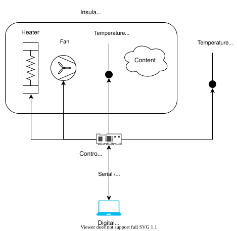

# Incubator Digital Twin

## Overview

This case study of an incubator shows the steps involved in developing
a digital twin system. The incubator is an insulated container that can
maintain a temperature by heating, but it cannot cool. A picture of the
incubator is shown below.


The system reaches a set temperature inside a box and holds that
temperature regardless of the content.
An overview of the system is shown below:



The system consists of:

* 1x Styrofoam box as the insulated container
* 1x heat source to heat the content of the Styrofoam box
* 1x fan to distribute the heat within the box
* 2x temperature sensors to monitor the temperature inside the box
* 1x temperature sensor to monitor the temperature outside the box
* 1x controller that actuates the heat source and the fan, reads
  the temperature sensors, and communicates with the digital twin

The example comes from the
[original repository](https://github.com/INTO-CPS-Association/example_digital-twin_incubator/).
This trimmed version of the codebase leaves out:

* docker support
* tests
* datasets

The original repository has the complete documentation of the example,
including the full system architecture and instructions for running with
a physical twin or a 3D visualisation of the incubator.

## Digital Twin Structure


This diagram shows the main components and the interfaces they use to
communicate. All components communicate through the RabbitMQ message
exchange, and the data is stored in a time series database.
RabbitMQ and InfluxDB are platform services hosted by the DTaaS.

The Incubator digital twin is pre-packaged. It can be used as is or
integrated with other digital twins.

The mock physical twin runs from the
`incubator/mock_plant/real_time_model_solver.py` script.

## Digital Twin Configuration

This example uses many Python scripts to run the digital twin.
By default, it runs with a mock physical twin. It also needs RabbitMQ
and InfluxDB instances.

There is one configuration file: `simulation.conf`.
The RabbitMQ and InfluxDB configuration parameters must be updated.

## Lifecycle Phases

The example covers these lifecycle phases:

| Lifecycle Phase | Completed Tasks                                                                                     |
| --------------- | --------------------------------------------------------------------------------------------------- |
| Create          | Installs missing system packages and the Python dependencies in a virtual environment               |
| Execute         | Executes the Incubator digital twin and produces output in the terminal and in _incubator/log.log_. |
| Clean           | Removes the log file.                                                                               |

## Run the example

To run the example, change to its directory.

```bash
cd /workspace/examples/digital_twins/incubator
```

If required, make the lifecycle scripts executable, for example:

```bash
chmod +x lifecycle/create
```

Now, run the following scripts:

### Create

Installs any missing system packages (Python 3 and venv) and the
Python dependencies in a virtual environment in
_common/digital\_twins/incubator/.venv_.

```bash
lifecycle/create
```

### Execute

Executes the Incubator digital twin with a mock physical twin.
Writes the results to the terminal, _incubator/log.log_ and InfluxDB.

```bash
lifecycle/execute
```

### Clean

Removes the output log file.

```bash
lifecycle/clean
```

## Examining the results

Once all services have started, the controller service produces output
like the following:

````log
time           execution_interval  elapsed  heater_on  fan_on   room   box_air_temperature  state
19/11 16:17:59  3.00                0.01     True       False   10.70  19.68                Heating
19/11 16:18:02  3.00                0.03     True       True    10.70  19.57                Heating
19/11 16:18:05  3.00                0.01     True       True    10.70  19.57                Heating
19/11 16:18:08  3.00                0.01     True       True    10.69  19.47                Heating
19/11 16:18:11  3.00                0.01     True       True    10.69  19.41                Heating
````

An InfluxDB dashboard can be set up from
`incubator/digital_twin/data_access/influxdbserver/dashboards/incubator_data.json`.
Once the dashboard is set up in InfluxDB, it shows the following
visualisation:


## References

Forked from:
[Incubator repository](https://github.com/INTO-CPS-Association/example_digital-twin_incubator/)
with commit ID: 989ccf5909a684ad26a9c3ec16be2390667643aa

The following resources explain what a digital twin is:

1. Feng, Hao, Cláudio Gomes, Casper Thule, Kenneth Lausdahl,
   Alexandros Iosifidis, and Peter Gorm Larsen. “Introduction to
   Digital Twin Engineering.” In 2021 Annual Modeling and Simulation
   Conference (ANNSIM), 1–12. Fairfax, VA, USA: IEEE, 2021.
   [https://doi.org/10.23919/ANNSIM52504.2021.9552135](https://doi.org/10.23919/ANNSIM52504.2021.9552135).
1. [Video recording of presentation by Claudio Gomes](https://videos.ida.dk/media/Introduction+to+Digital+Twin+Engineering+with+Cl%C3%A1udio+%C3%82ngelo+Gon%C3%A7alves+Gomes%2C+Aarhus+Universitet/1_7r1j05g8/256930613)
