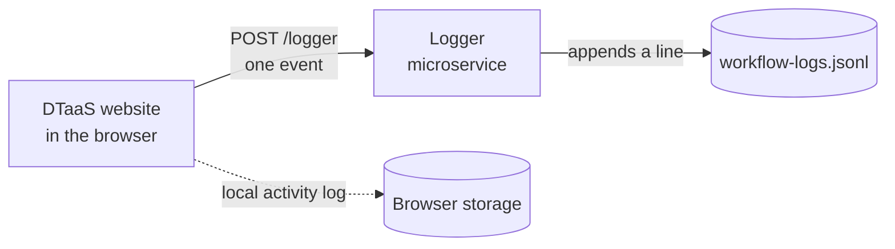

# Logger Microservice

The logger microservice receives workflow interaction events from the DTaaS
client and stores them as JSON Lines: one JSON object per line, one line per
event. The format suits command-line tools such as `jq` and data analysis
libraries alike.

## How Events Reach the Logger

The website records page navigation, button and tab clicks, form changes and
notifications. When remote logging is on, the browser sends each event to the
logger with the Beacon API, which does not wait for a reply, so logging never
slows the website down. The logger checks each event and appends it to its
log file.



The local activity log is separate. It stays in the browser and is shown on
the [Logs](../../website/logs.md) page.

## Enabling Remote Logging

Remote logging is off by default. When the installation has a logger, the
**Logging Settings** section on the **Settings** tab of the **Account** page
shows a **Send logs to ...** checkbox, followed by the logger's host name.
Select it and click **Save Settings**.


The two checkboxes are independent. **Keep a local activity log** stores the
events in the browser, and **Send logs to ...** sends them to the logger.
Keep remote logging on only with the consent of the person whose activity is
being recorded.

## What a Log File Contains

The following lines were recorded while a user opened the
**Digital Twins Page** from **Automation**, switched to the **Execute** tab,
opened and closed the execution history of **Hello World**, and then went
to the **Logs** page. Download them as
[workflow-logs-sample.jsonl](workflow-logs-sample.jsonl).

```json
{"sessionId":"70327d05-9dbc-454a-a358-6b8914fb37b9","userHash":"0a041b9462caa4a31bac3567e0b6e6fd9100787db2ab433d96f6d178cabfce90","timestamp":"2026-10-10T20:29:34.686Z","event":"navigation","page":"/account","element":"page","label":"/account","context":{}}
{"sessionId":"70327d05-9dbc-454a-a358-6b8914fb37b9","userHash":"0a041b9462caa4a31bac3567e0b6e6fd9100787db2ab433d96f6d178cabfce90","timestamp":"2026-10-10T20:29:36.233Z","event":"navigation","page":"/automation","page_transition":{"src":"/account","target":"/automation"},"element":"page","label":"/automation","context":{}}
{"sessionId":"70327d05-9dbc-454a-a358-6b8914fb37b9","userHash":"0a041b9462caa4a31bac3567e0b6e6fd9100787db2ab433d96f6d178cabfce90","timestamp":"2026-10-10T20:29:40.379Z","event":"navigation","page":"/preview/digitaltwins","page_transition":{"src":"/automation","target":"/preview/digitaltwins"},"element":"page","label":"/preview/digitaltwins","context":{}}
{"sessionId":"70327d05-9dbc-454a-a358-6b8914fb37b9","userHash":"0a041b9462caa4a31bac3567e0b6e6fd9100787db2ab433d96f6d178cabfce90","timestamp":"2026-10-10T20:29:44.317Z","event":"click","page":"/preview/digitaltwins","element":"tab","label":"Execute","context":{"dt":{"tab":"execute"}}}
{"sessionId":"70327d05-9dbc-454a-a358-6b8914fb37b9","userHash":"0a041b9462caa4a31bac3567e0b6e6fd9100787db2ab433d96f6d178cabfce90","timestamp":"2026-10-10T20:29:48.369Z","event":"click","page":"/preview/digitaltwins","element":"button","label":"History","context":{"dt":{"name":"hello-world","button":"history","executionCount":0}}}
{"sessionId":"70327d05-9dbc-454a-a358-6b8914fb37b9","userHash":"0a041b9462caa4a31bac3567e0b6e6fd9100787db2ab433d96f6d178cabfce90","timestamp":"2026-10-10T20:29:50.435Z","event":"click","page":"/preview/digitaltwins","element":"button","label":"Close","context":{"dt":{"name":"hello-world","button":"close-history"}}}
{"sessionId":"70327d05-9dbc-454a-a358-6b8914fb37b9","userHash":"0a041b9462caa4a31bac3567e0b6e6fd9100787db2ab433d96f6d178cabfce90","timestamp":"2026-10-10T20:29:52.481Z","event":"navigation","page":"/insights/log","page_transition":{"src":"/preview/digitaltwins","target":"/insights/log"},"element":"page","label":"/insights/log","context":{}}
```

Each line has the same fields:

| Field                 | Meaning in the sample                                                                                                      |
| :-------------------- | :------------------------------------------------------------------------------------------------------------------------- |
| `sessionId`           | A random identifier for one browser session. All seven events share it                                                     |
| `userHash`            | The SHA-256 hash of the username, computed in the browser. The logger never receives the username itself                   |
| `timestamp`           | When the event happened, in UTC                                                                                            |
| `event`               | `navigation` for a page change and `click` for a tab or button. The other types are `change`, `notification` and `dismiss` |
| `page`                | The page on which the event happened                                                                                       |
| `page_transition`     | On navigation events only: the page the user came from (`src`) and went to (`target`)                                      |
| `element` and `label` | What was used, such as the `button` labelled `History`                                                                     |
| `context`             | Details that depend on the page. On the Digital Twins Page, `dt` names the digital twin and the action                     |

The hash is the same every time a user signs in, so events can still be
grouped by user across sessions. It is a pseudonym, not anonymity.

## Analysing a Log File

The logger writes to `logs/workflow-logs.jsonl` unless it is configured
otherwise. These `jq` commands work on that file and on the sample.

Count the events of each type:

```bash
jq -s -c 'group_by(.event) | map({event: .[0].event, count: length})' \
  workflow-logs.jsonl
```

```json
[{"event":"click","count":3},{"event":"navigation","count":4}]
```

Follow the path a user took through the website:

```bash
jq -r 'select(.page_transition)
| "\(.timestamp) \(.page_transition.src) -> \(.page_transition.target)"' \ |
  workflow-logs.jsonl
```

```text
2026-10-10T20:29:36.233Z /account -> /automation
2026-10-10T20:29:40.379Z /automation -> /preview/digitaltwins
2026-10-10T20:29:52.481Z /preview/digitaltwins -> /insights/log
```

List what was done to digital twins:

```bash
jq -c 'select(.context.dt) | {timestamp, label, dt: .context.dt}' \
  workflow-logs.jsonl
```

```json
{"timestamp":"2026-10-10T20:29:44.317Z","label":"Execute","dt":{"tab":"execute"}}
{"timestamp":"2026-10-10T20:29:48.369Z","label":"History","dt":{"name":"hello-world","button":"history","executionCount":0}}
{"timestamp":"2026-10-10T20:29:50.435Z","label":"Close","dt":{"name":"hello-world","button":"close-history"}}
```

When the active file reaches its size limit, the logger renames it and starts
a new one, keeping a fixed number of old files. To analyse everything, pass
all of them to `jq`.

## Configuring the Website

The client sends events to the URL configured in `LOGGER_URL`. Include the
`/logger` route prefix, for example:

```javascript
LOGGER_URL: "https://example.com/logger";
```

For non-Docker local development, use the logger's direct port:

```javascript
LOGGER_URL: "http://localhost:4003/logger";
```

The API is specified in
[`servers/logger/API.md`](https://github.com/INTO-CPS-Association/DTaaS/blob/main/servers/logger/API.md).
Installing and configuring the logger is covered in the
[administrator guide](../../../admin/servers/logger/npm.md).
